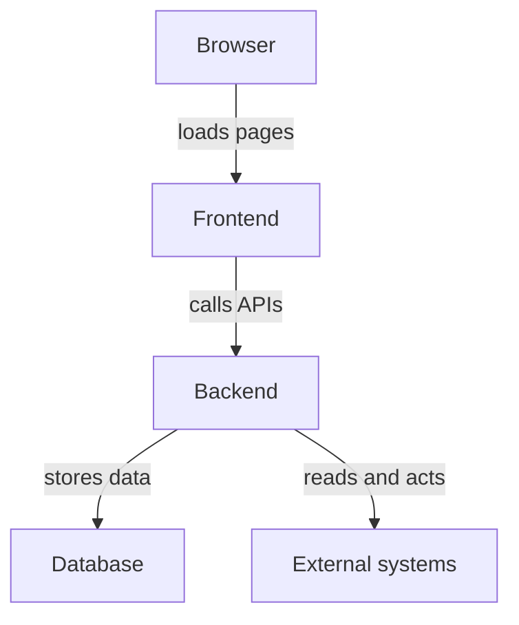

# What Backstage Is And How A Portal Is Assembled

A company with fifty teams usually has the same problem. Source code is in one system, build results in another, documentation in a third, and the list of who owns which service lives in a spreadsheet. A developer who needs to find the owner of a service must know which system to ask. This part explains what Backstage is, why it is called a framework, and what a running Backstage application consists of.

## Backstage is a framework for developer portals

A developer portal is a web application that gives developers one place to find software, documentation and self-service tools. Backstage is an open source framework for building such a portal. A framework is a set of reusable packages that you assemble into your own application. You do not install "the" Backstage portal. You create an application from the framework packages, choose the plugins you need and operate the result.

This is the first idea to hold on to for the exam. The Backstage project provides the building blocks and a command-line tool that creates a starting application. The organization that adopts Backstage owns the resulting application. It decides which features are installed, how users sign in, where the data is stored and how the application is upgraded.

## The parts of a running portal

A Backstage application has three kinds of parts. The first is the frontend, a web application that runs in the browser of the user. The second is the backend, a server process written in Node.js that provides the application programming interfaces (APIs), runs background work and talks to other systems. The third is the set of plugins, which add features to the frontend, the backend or both.

The backend also needs a database. Backstage stores its own data in a relational database, for example the catalog entities that it has collected. PostgreSQL is the database that Backstage recommends for production. SQLite is meant for local development and tests, because it can keep all data in the memory of the process.



The diagram shows that the browser never talks to the external systems directly. The backend does, with its own credentials, and the frontend only shows the result.

## One example from a running application

The playground for this module runs the public Backstage container image `ghcr.io/backstage/backstage:1.55.2` in a Deployment named `backstage` in the namespace `backstage`. The backend is the process `node packages/backend`. The Deployment passes two configuration files to it with the `--config` flag: the file `app-config.yaml` that ships in the image, and a file from a ConfigMap that the playground mounts. The backend listens on port 7007.

The first step is to look at how this Deployment starts the backend. The command below prints the container arguments, and the next one prints the container image. The first command shows that the application is started with a plain Node.js command and that its behaviour comes from configuration files. The second shows the exact release of the framework packages inside the image.

<!-- astrona:playground:renew -->

```sh
kubectl -n backstage get deployment backstage -o jsonpath='{.spec.template.spec.containers[0].args}{"\n"}'
kubectl -n backstage get deployment backstage -o jsonpath='{.spec.template.spec.containers[0].image}{"\n"}'
```

The arguments name `app-config.yaml` and `/etc/backstage/app-config.lab.yaml`. A file that is passed later takes priority over a file that is passed earlier, so the settings in the ConfigMap win over the settings in the image.

## The portal answers on one port

The backend serves the APIs and, in a standard application, also the files of the frontend. The playground forwards port 7007 of the service to the same port on your machine. The readiness endpoint of the backend reports whether its services have started. This endpoint is part of the backend system and needs no sign-in.

Run the request below. The first command prints only the HTTP status code of the readiness endpoint. The second prints the beginning of the page that the root address returns, which shows whether the frontend files are served by the same process.

```sh
curl -s -o /dev/null -w '%{http_code}\n' http://127.0.0.1:7007/.backstage/health/v1/readiness
curl -s http://127.0.0.1:7007/ | head -c 400; echo
```

A status code of 200 means that the backend considers itself ready. If the status code is 503 or the connection is refused, wait until the pod is ready and run the request again. If the root address returns an HTML page, the same process serves the frontend. If it returns an error, the image serves only the backend, and that is a fact about this image and not about all Backstage applications.

## What the framework gives you and what it does not

The framework gives you the structure of the application: how plugins are registered, how configuration is read, how the backend starts its services and how the frontend builds pages from extensions. It also gives you a large set of plugins from the community, for example for the catalog, for templates and for documentation. It does not give you the data. A new portal knows nothing about your services until someone connects a source of truth.

This is why a portal can look empty after installation. The catalog shows only entities that a configured source has delivered. A card that shows a deployment status exists only if a plugin is installed, an integration has credentials and the entity carries the annotation that links it to the system. Each of these steps is a decision of the adopting organization.

## Where the work happens

Backstage organizes information and starts actions. The systems it connects to do the actual work. A source code host stores the repositories. A continuous delivery system deploys the software. A cloud provider creates the infrastructure. When the backend of Backstage is down, these systems still run. When one of these systems is down, Backstage can only show an error or old data.

Say it as a rule: the portal presents and triggers, the external system performs. This rule helps in exam questions that ask which component is responsible for a failure. A wrong deployment status on a card is first a question about the plugin, the integration and the source system, and only then a question about the portal.

## How the pieces are put together

A Backstage application is a source code project, usually a monorepo, which means one repository with several packages. The Backstage command-line tool creates the first version of this project. The project contains the frontend package, the backend package and a configuration file. The team then adds plugins as package dependencies and registers them in the code of the frontend or the backend.

The project is then built into a container image. The playground skips this step and uses a ready-made image from the Backstage project, which exists for demonstration. A real organization builds its own image, because its image must contain its own plugin selection and its own code. The image is the unit that Kubernetes runs.

## Three questions that find the responsible component

Three questions help when a feature does not work. First: is the feature installed, that is, is the plugin part of the image? Second: is it configured, that is, does the configuration file contain the settings that the plugin reads? Third: is it permitted, that is, does the identity that the backend uses have access to the external system?

The answers point to different owners. A missing plugin is a build decision of the portal team. A missing setting is a configuration decision, often of the same team. A denied request is a decision of the team that owns the external system. Asking the three questions in this order avoids searching the wrong place.

## Reading the same facts in the cluster

A cluster shows the answers to these questions in different places. The image tag in the Deployment answers the first question for the whole application. The ConfigMap answers the second. The container log of the backend answers the third, because the backend writes a line when a call to an external system fails.

Run the command below to read the last lines of the backend log. The lines are produced by the backend itself, so their exact text depends on the image release. Look for the plugin names that the backend mentions while it starts, and for lines that report a failed start of a feature.

```sh
kubectl -n backstage logs deployment/backstage --tail=40
```

Do not worry if the log contains warnings about features that this demonstration image does not configure. A warning names the plugin that reports it, and that name tells you which package to look at.

## What you now know

Backstage is a framework that an organization assembles into its own application. A running application has a frontend in the browser, a backend process, a database and plugins. The configuration files decide most of its behaviour, and external systems do the real work. The open question is which features such a portal offers out of the box and how each of them gets its data.

## Common pitfalls

> [!WARNING]
> Do not describe Backstage as a hosted service or a finished product: the adopting organization builds, deploys and upgrades its own application. Do not assume that an installed portal knows your software: the catalog is empty until a source delivers entities. Do not read an empty card as proof that a service does not exist; it can also mean a missing plugin, a missing annotation or a failed integration.
