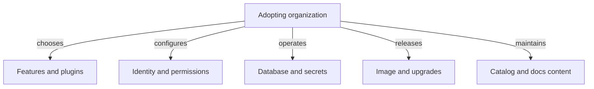

# What The Adopting Organization Owns

When a team installs a framework, it also takes over a list of duties that the framework cannot do for it. A Backstage portal is a production application with users, data, secrets and a release process. This part lists those duties, shows where each one appears in a running cluster, and explains why a missing duty shows up as a problem that looks like a defect in Backstage.

## The duties of the adopting organization

The first duty is the choice of features. The framework offers many plugins, and each one adds code to maintain, configuration to write and permissions to grant. A portal that tries to do everything gives a confusing result. The organization decides which problem the portal solves first, for example finding the owner of a service, and installs only the features that serve it.

The second duty is identity. Backstage supports several sign-in providers, and the organization chooses which one to configure. The third duty is authorization. After sign-in, a permission policy decides what a user may read or do. Backstage has a permission framework, but it ships with a policy that the organization normally replaces with its own rules.

The fourth duty is data. The backend needs a database that the organization creates, secures, backs up and monitors. The fifth duty is secrets. Tokens for source hosts, database passwords and keys for sign-in must reach the backend process without being stored in the image or in a file in the repository.

The sixth duty is operation. The organization decides how many replicas run, how a release is rolled out, which health checks Kubernetes uses and who is called when the portal is down. The seventh duty is upgrades. Backstage releases a new version every month, and the organization has to move its packages and plugins forward on its own schedule.

The last duty is the quality of the content. The portal shows what the catalog, the documentation and the integrations deliver. If teams do not update their descriptors, the portal shows wrong data with the same confidence as right data.

## One example: a database that lives only in memory

The playground configuration uses `better-sqlite3` with the connection `:memory:`. In this mode the database exists only inside the memory of the backend process. This is acceptable for a demonstration because the database is empty at every start. It is a wrong choice for production, because every restart removes everything that the catalog has stored.

The command below shows the database setting that the pod receives. Run it first, then restart the pod in the next step and think about what the backend lost. The command prints the mounted configuration file, and the `database` block shows the client and the connection.

<!-- astrona:playground:renew -->

```sh
kubectl -n backstage exec deployment/backstage -- cat /etc/backstage/app-config.lab.yaml
```

A production setup replaces this block with a PostgreSQL client and values from environment variables, and the database runs outside the pod with a volume or as a managed service. Creating the database and keeping backups is the duty of the organization, and no Backstage setting does it.

## Recording ownership in the cluster

An application also needs an owner in the place where it runs. In Kubernetes the usual way is a label or an annotation on the Deployment. Labels select objects, and annotations hold free-form information for tools and people. Next, add an annotation that names the team that owns the portal. The annotation key is a convention of this course and Kubernetes does not interpret it.

```sh
kubectl -n backstage annotate deployment backstage portal.starfleet.example/owner=platform-team --overwrite
kubectl -n backstage get deployment backstage -o jsonpath='{.metadata.annotations}{"\n"}'
```

The second command prints all annotations of the Deployment as JSON. The new annotation is part of the list. The Deployment controller does not restart the pod when an annotation of the Deployment itself changes, because only changes to the pod template cause a new rollout.

## What a restart removes

The pod is the unit that Kubernetes replaces. A restart creates a new pod, the backend starts with an empty in-memory database and reads its configuration again. The command below restarts the pod and waits for the readiness check to pass. Kubernetes marks a pod ready when the readiness probe of the container succeeds, and the Service sends requests only to ready pods.

```sh
kubectl -n backstage rollout restart deployment/backstage
kubectl -n backstage rollout status deployment/backstage --timeout=300s
```

When the command finishes, the new pod is ready. Everything the backend collected in memory before the restart is gone, and it has to collect the data again from its configured sources. The rollout shows that availability of the pod and persistence of the data are two different questions.

## The upgrade duty in numbers

The Backstage project publishes a main release line once a month and a next line every week. A release is a collection of packages at versions that were checked to work together. Individual packages follow semantic versioning, which means that their version numbers show the size of a change, and the release number does not.

An organization that skips many months has to apply many breaking changes at once. A team that upgrades every month applies a few small ones. The image tag in the Deployment shows which release the cluster runs, and the team can compare it with the current release to see how far behind it is.

## Where each duty appears

It helps to link each duty to the place where a failure becomes visible. A wrong or missing sign-in configuration appears when users try to log in. A missing database or a wrong password appears in the pod log at start-up and makes the pod fail its readiness check. A missing token appears when a plugin calls the external system and receives a denied response. An old release appears as a security notice about a package, which no log shows.

The following diagram groups the duties by the place where the team acts.



The diagram shows that every arrow starts at the organization. The Backstage project supplies the framework, and none of these five areas is filled by it.

## Reading a failure with the duties in mind

Assume that users report that the portal lost all its services after a night. The first question is whether the pod restarted. If it did, and the database is in memory, the cause is the persistence duty. If the pod did not restart, the next question is whether the source that delivers the entities still answers, which is the integration and the external system.

Assume instead that users report that a deployment card is empty for one service only. Then the entity probably lacks an annotation, which is a content duty of the owning team. The same symptom for every service points at the integration or the plugin. Sorting a problem by duty finds the responsible team faster than reading the Backstage code.

## What you now know

The adopting organization owns feature selection, identity, authorization, the database, secrets, operation, upgrades and the quality of the content. A running cluster shows these duties as a database setting, a mounted configuration, an environment of secrets, a rollout and a set of owners. The open question is how the application itself is built from packages, and which packages carry the frontend, the backend and the plugins.

## Common pitfalls

> [!WARNING]
> An in-memory database loses all data at every restart, even when the pod is healthy and ready. A ready pod shows only that the backend answers its health check, not that its data is complete or correct. Do not store tokens or passwords in the configuration file that is part of an image or a ConfigMap.
