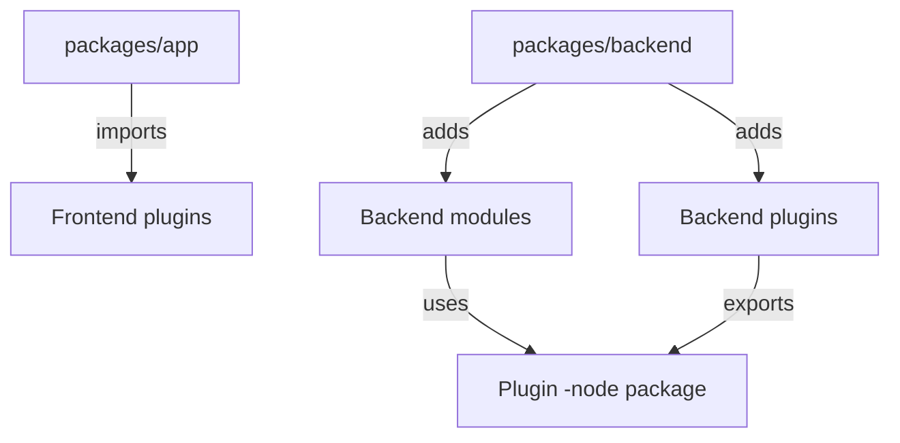

# The Project Layout: App, Backend And Plugin Packages

When a team opens a Backstage project for the first time, it finds many folders and hundreds of dependencies. Without a map, it cannot tell which folder is the portal, which folder holds a feature and which folder holds settings. This part gives the map: the standard layout of a project, the roles of its packages and the way a project becomes the image that Kubernetes runs.

## One repository, several packages

A Backstage project is a monorepo. A monorepo is one repository that contains several packages, each with its own `package.json` file. A package is a unit of code that has a name, a version and a list of dependencies. A package manager such as Yarn installs the dependencies of all packages together.

A project that the Backstage command-line tool creates has these top-level entries. The file `app-config.yaml` holds the configuration. The folder `packages` holds the two entry packages. The folder `plugins` is for plugins that the team writes itself. The file `package.json` at the top lists the workspaces, which are the folders that count as packages. A further file records the Backstage release that the project follows.

## The two entry packages

The package `app` is the frontend. It is the web application that runs in the browser. Its code decides which plugins are present, which pages exist and how the navigation looks. The package `backend` is the server. Its code decides which backend plugins and modules start in the process.

Both packages only wire things together. They contain few features themselves. The features come from plugin packages that the two entry packages import. A project can have more than one `app` or `backend` package. For example, a team can split the backend into several packages so that each deployment runs a smaller set of plugins.

## Plugin packages and their suffixes

A plugin is a feature that is delivered as one or more packages. Backstage names the packages with a shared prefix and a suffix that says what the package is for. The suffix is part of the contract, so it tells the reader which side of the system a package belongs to.

- `-backend`: the server part of a plugin. It runs inside the backend process.
- `-node`: shared code for the backend, for example the extension points of the plugin, so that modules and other plugins can use it.
- `-react`: shared code for the frontend, for example components that other plugins reuse.
- `-common`: code that runs on both sides. It must not depend on frontend or backend packages.
- No suffix: the frontend part of the plugin.
- `-backend-module-<name>`: a module that extends a backend plugin.

A plugin must not import the internal code of another plugin. It may use only the library packages `-react`, `-common` and `-node` of the other plugin. This rule keeps plugins independent, and it lets the team replace one plugin without breaking others.



The diagram shows that the entry packages import and add plugin packages, and that modules reach a plugin only through its `-node` package.

## How the project becomes an image

The build creates a bundle of the backend and the built frontend files, and a Dockerfile copies the bundle into a container image. The image runs `node packages/backend` with the configuration files as arguments. The image does not contain the source repository or the development tools. It contains the compiled code and the installed production dependencies.

The public image in the playground follows this model. It is useful for exploring, because it shows what an image contains. The details of the folder layout inside an image depend on the Dockerfile that built it, so the commands below show the real layout of this image. Run them one at a time and read the result carefully.

<!-- astrona:playground:renew -->

```sh
kubectl -n backstage exec deployment/backstage -- ls /app
kubectl -n backstage exec deployment/backstage -- ls /app/packages
```

The first command lists the working directory of the backend. The second lists the packages folder. Look for the names `backend` and `app`. If the image lists other entries, they are packages that the image builder added, and their names follow the rules above.

## Finding plugin packages in the image

The installed dependencies are in the folder `node_modules`. Packages that belong to Backstage are in the scope `@backstage`, which is a name prefix that groups the packages of one publisher. The command below lists the names in that folder that contain `plugin-` and ends with `-backend`.

```sh
kubectl -n backstage exec deployment/backstage -- sh -c 'ls /app/node_modules/@backstage | grep "^plugin-.*-backend$"'
```

Every name in the result is a backend plugin that the image carries. The result tells you which features the image can run, and it does not tell you which of them the configuration enables. A plugin that is present and not configured can stop the backend at start or stay inactive, depending on how the plugin treats missing settings.

## The configuration file next to the packages

The file `app-config.yaml` sits at the top of the project and is read by both entry packages. The backend reads it at start. The frontend receives only the part of it that is marked as visible to the browser, and the build or the backend delivers that part to the page. Other files such as `app-config.production.yaml` add settings for one environment on top of the first file.

The files are merged in the order of the `--config` flags. Objects are merged deeply, and a primitive value or an array in a later file replaces the earlier one. The playground uses this rule: the file in the ConfigMap comes last, so its values win over the values in the image.

## What the layout tells you about responsibilities

The layout answers the question "where does this change belong?". A new page for the user belongs to the frontend plugin and the `app` package. A new API belongs to a `-backend` plugin and the `backend` package. A setting such as a base URL belongs to `app-config.yaml`. A dependency version belongs to a `package.json` file.

A change in the wrong place causes confusing failures. A backend plugin that the team added to `package.json` but did not register in the `backend` package does not run. A frontend plugin that is installed but not added to the `app` package shows no page. In both cases the code compiles and the feature is still missing, because installation and registration are two separate steps.

## What you now know

A Backstage project is a monorepo with the entry packages `app` and `backend`, plugin packages with role suffixes, and a configuration file. The build turns it into an image that runs `node packages/backend`. The open question is how the backend combines its plugins, and how one plugin can extend another one.

## Common pitfalls

> [!WARNING]
> A plugin package in `node_modules` is installed, not enabled: it also has to be registered in the `app` or `backend` package and configured. Do not import the internal code of another plugin; use its `-react`, `-common` or `-node` package. The folder layout inside an image depends on how the image was built, so check the image instead of assuming it.
