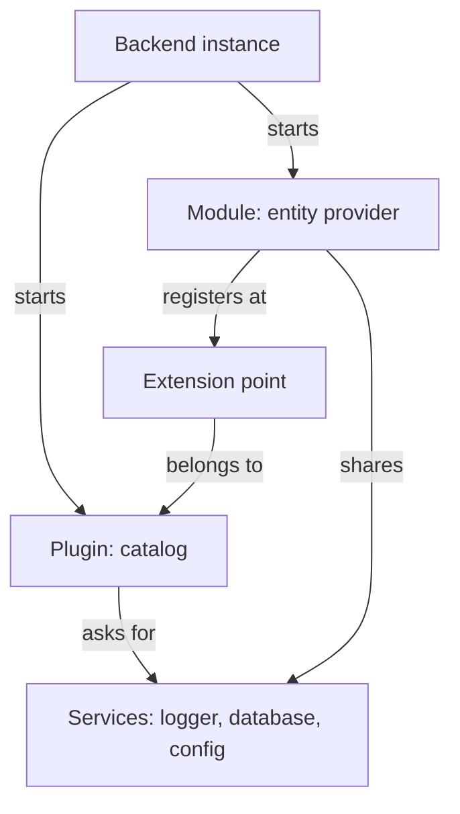

# The Backend System: Plugins, Modules, Extension Points And Services

The backend of a portal has to run many features in one process, and each feature needs a database, a logger and configuration. It also has to let one feature extend another, for example a company-specific source of catalog entities. The backend system solves both needs with four concepts. This part explains them with the names that appear in the code, in the logs and on the exam.

## The backend instance

The backend instance is the process that Kubernetes runs. It has no features of its own. It only wires plugins, modules and services together and starts them. In the code of the `backend` package, a function creates the instance, and the team adds plugins and modules to it one by one.

The code below is a typical example of such a file. It is shown to read. The playground image already contains a compiled version of a file like this one, and you do not change it.

```ts
import { createBackend } from '@backstage/backend-defaults';

const backend = createBackend();

backend.add(import('@backstage/plugin-app-backend'));
backend.add(import('@backstage/plugin-catalog-backend'));
backend.add(import('@backstage/plugin-scaffolder-backend'));
backend.add(import('@backstage/plugin-search-backend'));

backend.start();
```

Each `backend.add` call registers one feature. If a line is missing, the feature is missing from the process, even when the package is installed. This is the registration step from the layout of the project.

## Plugins

A backend plugin provides one feature and has a plugin ID, a short name such as `catalog` or `scaffolder`. Plugins are independent of each other. A plugin cannot call the code of another plugin. When plugins need to talk, they send requests over the network, as if each plugin were a small service. The plugin ID is also the base of its HTTP path, so the requests of the catalog plugin go below `/api/catalog`.

This independence has a practical result. An organization can run all plugins in one backend, or it can split them into several deployments to scale or isolate them. The calls between plugins use the network in both cases, and that is why a plugin split into its own deployment still works.

## Services

A service is a shared utility that the backend system provides to plugins, so that each plugin does not have to build the same function again. The core services include logging, reading configuration, access to the database, the HTTP router, scheduled tasks, authentication of callers and the discovery of other plugins. A plugin declares which services it needs, and the backend system gives them to it when the plugin starts.

Because the backend gives each plugin its own service instances, a plugin gets a database that belongs only to that plugin. A plugin cannot read the tables of another plugin by accident. The database service uses the settings under `backend.database` in the configuration. With one PostgreSQL server, Backstage can create one logical database per plugin, so each plugin can run its own migrations.

Services are also a customization point. An organization can replace the default implementation of a service in its own backend, for example to change how the logger formats lines. All plugins then use the replacement without changes to their code.

## Extension points and modules

An extension point is a place where a plugin allows other code to add behaviour. The catalog plugin has extension points for entity providers, which add entities from a new source, and for processors, which change entities while they are processed. The scaffolder plugin has an extension point for custom actions.

A module is the package that uses an extension point. A module extends exactly one plugin, and it must run in the same backend instance as that plugin. It shares the services of the plugin. The name pattern for such a package is `plugin-<pluginId>-backend-module-<moduleId>`.



The diagram shows that a module never reaches into the plugin code. It registers at an extension point that the plugin exposes, and both use the same services.

## What you can observe in the playground

A running backend writes a log line for its start, and many lines mention the plugin that wrote them. The command below prints the beginning of the log. The exact text depends on the image release, so read it for plugin names and for lines that report problems, and do not look for a fixed sentence.

<!-- astrona:playground:renew -->

```sh
kubectl -n backstage logs deployment/backstage | head -n 40
```

If the log shows names such as `catalog` or `scaffolder`, those are plugin IDs. The next command tests that a plugin ID is part of an HTTP path. The request asks the catalog plugin for a resource without a user token. The backend system rejects requests that carry no valid credentials by default, so the status code you receive tells you that the route exists and that authentication is active.

```sh
curl -s -o /dev/null -w '%{http_code}\n' http://127.0.0.1:7007/api/catalog/entities
```

A status code of 401 means that the route `/api/catalog` exists and that the request was refused for lack of credentials. A status code of 404 would mean that the plugin is not installed or not registered in this image. Both results teach something about the backend: it routes by plugin ID, and it checks the caller before it runs the plugin code.

## Why this design matters for operations

Because plugins run in one process, they share its memory and its crashes. A plugin that fails at start can stop the whole backend. A plugin that takes too long in a scheduled task can slow other plugins. The ability to split plugins into more than one deployment is the tool that an organization uses against this.

Because modules run in the process of the plugin they extend, a new entity provider does not need its own deployment. It needs a build with the module package added and registered. The team that owns the plugin can add or remove it in one change to the `backend` package.

## What you now know

The backend instance starts plugins and modules. Plugins provide features and talk to each other over the network. Services give plugins their logger, configuration and database. Extension points let a module add behaviour to one plugin. The open question is how the frontend is built in a similar way, and how the versions of all these packages stay compatible.

## Common pitfalls

> [!WARNING]
> A module runs only when it is registered in the backend instance together with the plugin it extends. A plugin cannot call the code of another plugin; it must send a request. A response of 401 from a plugin route is not a failure of the route: it shows that the route exists and that the caller is not authenticated.
