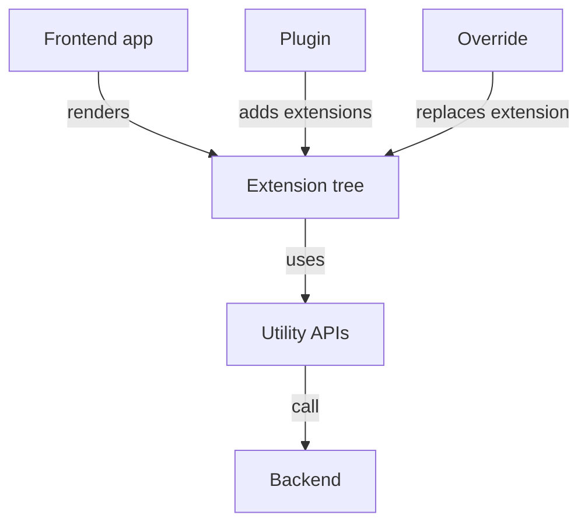

# The Frontend, Versions And Upgrades

The frontend is the part of the portal that users see, and it has to combine the pages of many plugins into one application. The packages of a portal also come from many authors with many version numbers, and a wrong combination breaks the application at start or at run time. This part explains how the frontend is assembled from plugins and extensions, and which version rules keep the packages compatible.

## The frontend app and its plugins

The frontend app is the root of the browser application. Like the backend instance, it has no features of its own. It wires plugins together and renders the result. A frontend plugin provides features such as a page, a card for the page of an entity or a navigation item. Plugins can stand alone or extend other plugins, and they work together by composing extensions or by sharing routes and utility APIs.

An extension is one building block of the page. It can be visible, such as a page or a card, or non-visible, such as a provider of data. Every extension attaches to a parent extension, can have children and passes data to its parent. The app combines all extensions into one tree and renders the tree. A plugin therefore adds a feature by adding extensions to the tree.

## Overrides, utility APIs and routes

An extension override is a high-priority replacement for an existing extension. An organization uses it to change a page of a plugin, to replace the theme of the application or to swap one extension for its own version without changing the plugin package.

A utility API is a function that extensions use to share a capability, for example reading configuration or calling the backend. Each utility API has a TypeScript interface, and the implementation is provided by an extension. Because the implementation is an extension, it can be overridden as well. This is how a frontend component can call the backend without knowing how the call is made.

A route is a reference that lets one plugin link to a page of another plugin without knowing its URL path. The app resolves the references to real paths when it builds the tree. If an organization moves a page to another path, the links of other plugins still work.



The diagram shows that plugins and overrides both change the same extension tree, and that data leaves the browser only through utility APIs that call the backend.

## Why the frontend has no secrets

The browser downloads the frontend code and runs it on the computer of the user. Everything in the code and in the configuration that reaches the page can be read by the user. A token that a frontend plugin needs for an external system must therefore stay in the backend, and the frontend asks the backend plugin to make the call.

This is the reason for the split into `app` and `backend` packages. It is also the reason why a configuration value must be marked as visible to the frontend before the browser can read it. A value without this mark stays on the server.

## Versions: the release and the packages

A Backstage release is an umbrella version, for example 1.55.2 for the image in the playground. Each release is a collection of packages at specific versions that the project verified to work together. The release number does not follow semantic versioning for the minor version: every scheduled release raises the minor number and can bring new features, bug fixes and breaking changes. Major versions are rare. A patch version appears only for a critical bug fix.

The individual packages do follow semantic versioning, independent of the release number. A package can keep the same version across several releases, or reach a new major version in one release. The change log of a package marks breaking changes. When a package reaches version 1.0.0 or higher, a stable export is normally deprecated first and removed later.

## The compatibility rules between packages

The packages of the application core, which are the framework packages that the `app` package uses, must all come from the same release. The core and library packages of one plugin must also come from the same release. Plugin packages may be older than the application core, because the framework tries to keep old plugins working for a while.

One more rule matters for deployments. If a frontend plugin has a backend counterpart, the backend must be deployed before the frontend, or together with it. A new frontend that calls a route that the old backend does not have fails with an error in the browser. The reverse order is safe, because an old frontend can still call a new backend that keeps the old routes.

## Upgrading in practice

A project records the release it follows in a file at its top level, and the Backstage command-line tool has a command that moves all Backstage packages in the project to a release together. The team then installs the dependencies, builds the image and runs its tests. Skipping that command and changing single package versions by hand leads to a mix of versions that the project never checked.

The next steps read the version information of the playground image. The first command prints the image tag of the Deployment. The second prints the version field of one framework package inside the image. The package exists in the image if the command prints a line, and if it prints an error, use the list of packages from the folder `node_modules/@backstage` to pick another one.

<!-- astrona:playground:renew -->

```sh
kubectl -n backstage get deployment backstage -o jsonpath='{.spec.template.spec.containers[0].image}{"\n"}'
kubectl -n backstage exec deployment/backstage -- sh -c 'grep "\"version\"" /app/node_modules/@backstage/plugin-catalog-backend/package.json'
```

The image tag is a release number of the framework. The package version is its own number, and the two do not need to match. Compare them to see the rule that the package versions are independent of the release.

## Checking that a pinned image is deliberate

The Deployment uses a fixed tag instead of `latest`. A fixed tag means that the same pod template starts the same code every time. The tag `latest` can change under the Deployment, so a pod that restarts for any reason can start a new release with no review. The command below shows the pull policy and the tag together.

```sh
kubectl -n backstage get deployment backstage -o jsonpath='{.spec.template.spec.containers[0].image}{" "}{.spec.template.spec.containers[0].imagePullPolicy}{"\n"}'
```

The upgrade of the cluster is then a visible change of the tag in the manifest, and a code review or a rollout record shows it.

## Reading an upgrade failure

A failed upgrade usually shows one of three symptoms. The build fails because a package removed an export that the code still uses. The backend fails at start because a plugin expects a service or a setting that the new release changed. The browser shows an error because a frontend plugin calls a backend route that does not exist in the deployed backend.

Each symptom points at a different rule. The first points at breaking changes in the change log of one package. The second points at plugins and core packages from different releases. The third points at the deployment order of frontend and backend. Naming the symptom first saves time, because it tells you which rule to check.

## What you now know

The frontend app renders a tree of extensions that plugins and overrides provide, and it reaches the backend only through utility APIs. Releases are umbrella versions of packages that were verified together, the packages keep their own semantic versions, and the core packages of one release must stay together. The open question is how settings and secrets reach each of these parts, which the configuration of the application decides.

## Common pitfalls

> [!WARNING]
> Do not change single Backstage package versions by hand: use the upgrade command so that the whole set stays on one release. Deploy the backend before or together with a frontend that needs it. Do not put a token in a frontend plugin or in a value that is visible to the browser; the user can read it.
