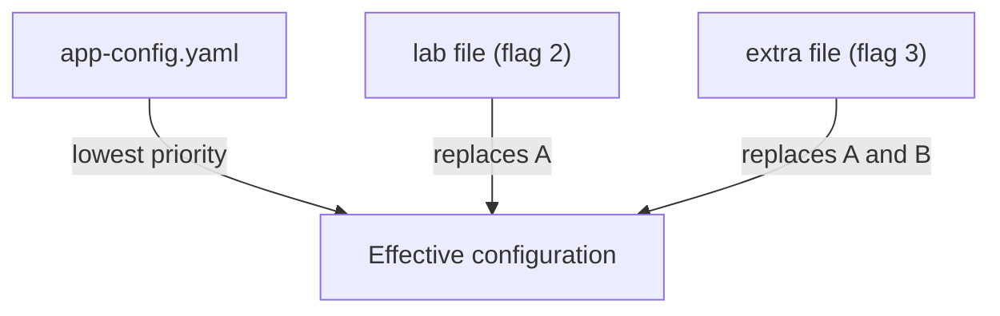

# App Configuration Files And The `--config` Order

A Backstage application has no settings built into its code that an operator can rely on. Everything that differs between two deployments, such as the title of the portal, the address of the backend or the database, comes from configuration. This chapter explains which files Backstage reads, in which order, and how the `--config` flag changes that. Without this order you cannot tell which file a running portal really uses.

## Configuration is YAML read at startup

Backstage reads its configuration from YAML files when the process starts. The base file is `app-config.yaml`. It sits in the root of the Backstage project, and the container image of a Backstage application carries a copy of it in the working directory of the backend process, `/app`. The same configuration object is then handed to the frontend and backend code. Only values marked for the browser reach the frontend.

The file `app-config.yaml` is required by default. If it is missing and no other source is given, the process stops. All other files are optional. Backstage loads them only when they exist.

Three kinds of file are normally used. The base file holds settings that are the same everywhere. The file `app-config.local.yaml` holds overrides for one developer machine and is normally kept out of version control. Files named `app-config.<environment>.yaml`, for example `app-config.production.yaml`, hold settings for one environment.

## Default order without `--config`

The environment name comes from the variable `BACKSTAGE_ENV`. It accepts one value or a comma-separated list. For the value `production`, Backstage loads `app-config.yaml`, then `app-config.production.yaml`, then the local files. All files for an environment are loaded before any local file, so local files take precedence. When the list has several environments, they load from left to right, so the last one wins.

The rule to remember is simple: later files replace earlier ones. The base file is the weakest source and the local file is the strongest of the default files.

## The `--config` flag takes over

A deployment often cannot use the default names, because the files come from somewhere else, such as a Kubernetes ConfigMap. For that case the process accepts `--config <path>` as many times as needed. The path can be a local path or a URL. A local path is relative to the working directory of the process that runs Backstage.

Two facts about the flag decide almost every problem in this area. First, as soon as one `--config` flag is given, the default `app-config.yaml` files are not loaded at all. Second, the files are ordered by their flags and the last flag has the highest priority. So a command line that names only an overlay file runs without the base file, and a command line that names the base file first and an overlay second gives the overlay priority.



The diagram shows three files given with three flags. Each later file wins over the earlier ones for any key that more than one of them sets.

## What the playground runs

The Backstage in the playground is a Deployment named `backstage` in the namespace `backstage`. Its container runs `node packages/backend` with two flags: the file `app-config.yaml` from the image and a second file, `/etc/backstage/app-config.lab.yaml`, which Kubernetes mounts from a ConfigMap. Because the second flag comes last, its values win.

<!-- astrona:playground:renew -->

Read the command and the arguments from the Deployment. The `command` field replaces the image entrypoint and `args` holds the flags:

```sh
kubectl -n backstage get deploy backstage -o jsonpath='{.spec.template.spec.containers[0].command}{"\n"}{.spec.template.spec.containers[0].args}{"\n"}'
```

The output shows the same two `--config` flags that this chapter describes. The first points at the file inside the image and the second at the mounted file.

Next, read the mounted file from inside the running pod. The kubelet (the Kubernetes node agent) wrote it from the ConfigMap key `app-config.lab.yaml`:

```sh
kubectl -n backstage exec deploy/backstage -- cat /etc/backstage/app-config.lab.yaml
```

The file sets the portal title, the address of the backend and an in-memory SQLite database. These values override the same keys in the `app-config.yaml` inside the image. You can look at the base file too:

```sh
kubectl -n backstage exec deploy/backstage -- cat /app/app-config.yaml
```

Compare the two files key by key. For every key that appears in both, the mounted file is the effective value. For every key that appears only in the base file, the base file is the effective value, because objects merge.

## Why a second file is better than editing the first

The `app-config.yaml` in the image is part of the build. Changing it means building a new image. A mounted file can change per environment without a rebuild. Keeping settings that differ between environments in a mounted file, and settings that never differ in the image, is the usual production layout.

The file can also be a URL, but remote loading needs the remote option in the code that loads the configuration. This course uses only local paths.

## What a ConfigMap change does not do

Kubernetes updates the files of a mounted ConfigMap in the pod after some time. Backstage reads its files when it starts. A running process does not read them again, so a changed value reaches Backstage only after the pod restarts. The usual command is `kubectl rollout restart`, which replaces the pod with a new one that reads the files again.

```sh
kubectl -n backstage rollout restart deployment/backstage
kubectl -n backstage rollout status deployment/backstage --timeout=300s
```

The second command waits until the new pod passes its readiness probe. The probe calls the health endpoint of the backend, so a pod that cannot parse its configuration never becomes ready.

## When the new file does not load

A mounted file that is not where the flag says it is stops a correct start. A wrong `mountPath`, a wrong ConfigMap key name or a missing ConfigMap all lead to that state. The pod then never becomes ready, because readiness depends on a running backend. When a pod does not become ready, read its log and the pod events, and compare the path in the `--config` flag with the `mountPath` of the volume in the Deployment:

```sh
kubectl -n backstage logs deploy/backstage --tail=30
kubectl -n backstage describe pod -l app=backstage
```

The log shows what Backstage reported and the events show what Kubernetes reported, for example a ConfigMap that could not be mounted. Always read both before you change anything.

## Summary of the chapter

You now know that Backstage reads `app-config.yaml` and optional environment and local files, that `--config` replaces the default list and that the last flag wins. You also saw how the playground applies this with a mounted ConfigMap. One question remains: what exactly happens to a key that two files both set.

## Common pitfalls

> [!WARNING]
> - Giving one `--config` flag and expecting `app-config.yaml` to load as well. It does not load unless you name it.
> - Putting the overlay flag before the base flag. The last flag wins, so the base file then replaces the overlay.
> - Using a path that is relative to the file and not to the working directory of the process.
> - Editing a mounted ConfigMap and expecting the running process to change. Restart the pod.
