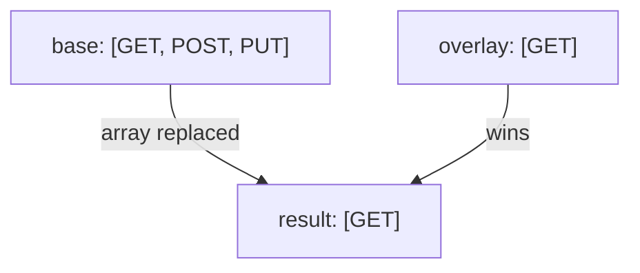

# Merge Rules: Objects, Primitives, Arrays And `null`

When two configuration files set the same key, Backstage has to decide what the final value is. The answer depends on the type of the value, and the wrong guess is the most common reason why a setting seems to be ignored. This chapter states the rules, works through examples that you can check by reading the files, and then applies a change to the playground.

## The four rules

Backstage merges the sources in priority order, with the later source on top. Four rules apply to the values:

- Objects are merged together deeply. Keys that exist in only one file stay, and keys that exist in both are merged again one level down.
- Primitive values (a string, a number or a boolean) are replaced completely by the later value.
- Arrays are replaced completely, with all of their contents. Two arrays are never joined.
- A `null` value in a file is treated as an explicit absence of configuration.

These rules are the same for every source, whether it is a file, an `APP_CONFIG_` variable or an included file.

## A worked example with objects and primitives

Take a base file and an overlay file, in this order of priority:

```yaml
# app-config.yaml (lower priority)
app:
  title: Starfleet Portal
  baseUrl: http://localhost:3000
backend:
  listen:
    port: 7007
```

```yaml
# app-config.production.yaml (higher priority)
app:
  baseUrl: https://portal.example.com
```

The result has `app.title` from the base file, because the overlay does not mention it. It has `app.baseUrl` from the overlay, because a string is replaced. It keeps `backend.listen.port` from the base file, because the overlay has no `backend` key at all. The overlay is short on purpose. An overlay file only needs the keys that differ.

## Arrays are replaced, not extended

Many settings are lists. Look at the next pair of files. The setting is `backend.cors.methods`, the list of HTTP methods that the backend allows for cross-origin requests:

```yaml
# lower priority
backend:
  cors:
    methods: [GET, HEAD, PATCH, POST, PUT, DELETE]
```

```yaml
# higher priority
backend:
  cors:
    methods: [GET]
```

The result is the list `[GET]`. Backstage does not keep `HEAD`, `PATCH`, `POST`, `PUT` or `DELETE`. Anyone who adds one more method in an overlay must write the full list again. The same is true for lists of objects, such as a list of catalog locations or a list of integrations: one overlay entry replaces the whole list from the base file.



The diagram shows that the overlay array is the result. The base array contributes nothing once the overlay sets the same key.

## `null` removes a value

A `null` in a later file marks a setting as absent. This is useful when the base file sets a value that one environment must not have. The overlay sets the key to `null` and the application reads the setting as not configured:

```yaml
# higher priority
backend:
  cors: null
```

The result has no `backend.cors` at all, even though the base file defines it. Code that reads the key with an optional reader, such as `getOptionalConfig`, then sees nothing. Code that requires the key fails. This differs from an empty string, which is a real value, and from leaving the key out of the overlay, which keeps the base value.

## Reading the effective result

You can always find the effective value of a key by walking the sources from the highest priority to the lowest and stopping at the first one that sets the key. If that value is an object, continue merging with the lower sources for its child keys. If it is a primitive, an array or `null`, you are done.

The words in the Backstage documentation are plain: primitive values are replaced, arrays are replaced with all of their contents, objects are merged deeply, and `null` is an explicit absence. Learn these four statements. They are easy to test on an exam as a small scenario with two files.

## Try it in the playground

The ConfigMap `backstage-app-config` in the playground holds the file that the second `--config` flag reads. Add an array setting to it. Save this as `backstage-app-config.yaml`. It is the whole ConfigMap again, with one new key, `methods`, under `backend.cors`:

```yaml
apiVersion: v1
kind: ConfigMap
metadata:
  name: backstage-app-config
  namespace: backstage
data:
  app-config.lab.yaml: |
    app:
      title: Starfleet Portal
      baseUrl: http://localhost:7007
    organization:
      name: Starfleet
    backend:
      baseUrl: http://localhost:7007
      listen:
        port: 7007
      cors:
        origin: http://localhost:7007
        methods: [GET, POST]
      database:
        client: better-sqlite3
        connection: ':memory:'
```

<!-- astrona:playground:renew -->

Apply it:

```sh
kubectl apply -f backstage-app-config.yaml
```

The file inside the pod changes after a short delay, but the Backstage process still has the old configuration. Restart the pod so that the new file is read, and wait for it to become ready:

```sh
kubectl -n backstage rollout restart deployment/backstage
kubectl -n backstage rollout status deployment/backstage --timeout=300s
```

Then check that the new file is mounted in the new pod:

```sh
kubectl -n backstage exec deploy/backstage -- cat /etc/backstage/app-config.lab.yaml
```

The file now lists `methods: [GET, POST]`. If the base file in the image also has a `methods` list, yours replaces it as a whole. You can read the base file with `kubectl -n backstage exec deploy/backstage -- cat /app/app-config.yaml` and look for the key. A pod that becomes ready shows that Backstage parsed the merged result without an error.

## What you now know

Backstage merges objects, replaces primitives and arrays, and treats `null` as removal. You applied a change by editing the mounted ConfigMap and restarting the pod. The remaining question is how single values enter from outside the files, for example from an environment variable that a Kubernetes Secret provides.

## Common pitfalls

> [!WARNING]
> - Adding one item to a list in an overlay. The overlay list replaces the base list, so write every item.
> - Setting a key to an empty string when the intention is to remove it. Use `null`.
> - Repeating a whole object in an overlay. Only the changed keys are needed, and repeating the rest hides later changes in the base file.
> - Checking the ConfigMap and not the running pod. The process reads the files only at startup.
