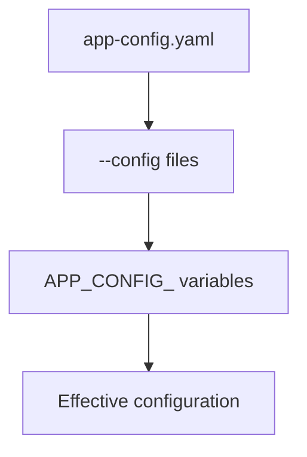

# Environment Overrides And Substitutions

Files are not the only source of configuration. A container platform such as Kubernetes passes values to a process as environment variables, and a secret should never be written into a file that is stored in a repository. Backstage supports both needs in two different ways: overrides that replace a value from outside the files, and substitutions that pull a value into a file. This chapter explains both and the priority between all sources.

## `APP_CONFIG_` environment variables

An environment variable whose name starts with `APP_CONFIG_` overrides a single configuration value. Everything after the prefix is the key. An underscore in the name stands for a dot in the key path. So `APP_CONFIG_app_baseUrl` overrides `app.baseUrl`, and `APP_CONFIG_organization_name` overrides `organization.name`.

The value of the variable is parsed as JSON. If it does not parse, Backstage uses it as a string. That rule has a consequence: the text `true` becomes the boolean `true`, the text `7007` becomes the number 7007 and the text `[1,2]` becomes an array. A value that must stay a string although it looks like JSON needs JSON quotes, so the variable holds `"false"` with the quotes included. A title such as `Starfleet Command` does not parse as JSON, so it stays a string.

Variables have the highest priority of all sources. They win over every file, no matter the order of the `--config` flags. Backstage recommends using them sparingly, mainly for a temporary change or to reuse one deployment artifact in several environments. For a permanent setting, a file is easier to review.

Key names in `APP_CONFIG_` variables must be valid key names. A key that contains a dot or a character outside letters, digits, `-` and `_` cannot be expressed in this way.

## Substitutions inside files

A file can ask Backstage to fill in a value when the file is loaded. Backstage resolves these at startup and the reader sees only the final value. Three special keys start with a dollar sign:

- `$env` reads a string value from an environment variable.
- `$file` reads the content of a file as a string. The file path is relative to the file that contains the key.
- `$include` loads and parses a `.json`, `.yml` or `.yaml` file and puts the parsed data in its place.

A value of the form `${NAME}` inside a longer string also reads an environment variable. The Backstage guide for Kubernetes uses it for the database settings, for example `host: ${POSTGRES_HOST}`.

```yaml
backend:
  database:
    client: pg
    connection:
      host: ${POSTGRES_HOST}
      port: ${POSTGRES_PORT}
      password:
        $file: /etc/secrets/db-password
```

In this file the host and the port come from environment variables and the password comes from a file that Kubernetes mounts from a Secret. The configuration file itself holds no secret value and is safe to store in a ConfigMap or a repository.

## Priority between all sources

The overall order, from the lowest priority to the highest, is: the default files, then files named with `--config` flags in order, then `APP_CONFIG_` variables. Substitutions do not have a priority of their own. They run while a file is loaded, so the value counts at the priority of the file that contains the substitution.



The diagram reads from the weakest to the strongest source. The value that the last source sets for a key is the value that Backstage uses.

## Which tool for which job

Use a file for settings that belong to the application and should be reviewed. Use `${NAME}` or `$env` when a value differs per environment and the file stays the same. Use `$file` when the value is already a file, as a mounted Kubernetes Secret is. Use `$include` to split a long file into parts. Use an `APP_CONFIG_` variable for a single value that you must change without touching a file.

A substitution refers to something outside the file, so the thing it refers to must exist. Check that a variable is defined in the Deployment before you reference it, and read the startup log of the pod if Backstage does not become ready after you add a reference.

## Try it in the playground

Set a variable on the Deployment so that the portal title changes without a change to any file. The command adds the variable to the container and Kubernetes starts a new pod:

<!-- astrona:playground:renew -->

```sh
kubectl -n backstage set env deployment/backstage APP_CONFIG_organization_name="Starfleet Command"
kubectl -n backstage rollout status deployment/backstage --timeout=300s
```

The variable `APP_CONFIG_organization_name` overrides `organization.name`, which the mounted file sets to `Starfleet`. Check that the variable reached the container:

```sh
kubectl -n backstage exec deploy/backstage -- printenv APP_CONFIG_organization_name
```

The value printed is the text you set. The mounted file still says `Starfleet`. This shows the priority: the file is unchanged and the variable wins inside Backstage. You can list the variables of the Deployment too:

```sh
kubectl -n backstage get deploy backstage -o jsonpath='{.spec.template.spec.containers[0].env}{"\n"}'
```

To remove the override, delete the variable by putting a dash after its name and wait for the rollout:

```sh
kubectl -n backstage set env deployment/backstage APP_CONFIG_organization_name-
kubectl -n backstage rollout status deployment/backstage --timeout=300s
```

## What you now know

You can override one value with an `APP_CONFIG_` variable, read values into a file with `$env`, `${NAME}`, `$file` and `$include`, and place every source in the priority order. The pattern that follows is the standard one for Kubernetes: a ConfigMap carries the non-secret file and a Secret carries the sensitive values, which reach Backstage as variables or files.

## Common pitfalls

> [!WARNING]
> - Writing the key in an `APP_CONFIG_` name with different letters than the real key. Copy the key from the file, for example `baseUrl`, and replace each dot with an underscore.
> - Forgetting that the value is parsed as JSON. A value `false` is a boolean, not the string `"false"`.
> - Referencing `${NAME}` for a variable that the Deployment does not define. The value cannot be resolved, so the pod may never become ready.
> - Expecting a changed environment variable to apply to a running pod. Kubernetes starts a new pod when the pod template changes, and the process reads the variable only at startup.
