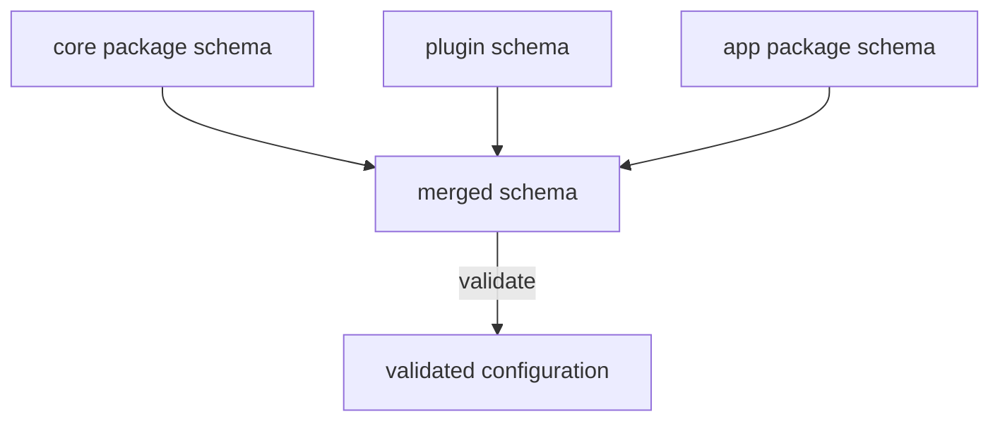

# Configuration Schemas And Typed Reads

A YAML file can contain any text. A running application needs the opposite: a value of a known type under a known key, or a clear error. Backstage solves this with two mechanisms. Schemas declare which keys exist and what type each one has. Typed readers give code the value in that type. This chapter explains both, because they explain why a wrong value stops a deployment and why a setting you invented is not available to the code.

## Where a schema lives

Every package that has configuration declares one schema. The declaration is the top-level `configSchema` field in the `package.json` of that package. The field holds either the schema itself as JSON schema or a relative path to a file with the schema. Two file formats are supported: a `.json` file with a JSON schema, and a `.d.ts` file with TypeScript types. A TypeScript schema file exports a single `Config` type.

The most common choice is a file named `config.d.ts` next to the `package.json`, with the entry `"configSchema": "config.d.ts"`. When a schema file is used, the file must also be listed in the `files` field of the `package.json`, or it is not published with the package and the schema is lost.

```ts
export interface Config {
  starfleet?: {
    /**
     * Name of the fleet shown in the portal header.
     * @visibility frontend
     */
    fleetName: string;
    /** Number of ships shown on the overview page. */
    maxShips?: number;
  };
}
```

This schema declares an optional top-level key `starfleet` with a required string `fleetName` and an optional number `maxShips`. The annotation `@visibility frontend` in the comment controls who can see the value. The plain description comment above `maxShips` has no effect on behaviour and only documents the key.

## How schemas combine

Backstage does not use one schema for the whole application. When the application starts, it collects the schemas of all packages that qualify and stitches them into a single schema. A package qualifies when it has at least one dependency on a `@backstage` package or has a `configSchema` field in its `package.json`. The search covers the root package and its dependencies, including indirect ones.

This is why a plugin that you install brings its own configuration keys. The plugin ships its schema, and the merged schema now knows those keys. It is also why two packages that describe the same key in conflicting ways cause an error during the merge.



The diagram shows that each package contributes a schema and that the merged schema validates the configuration the application loaded.

## Validation catches wrong types early

The loaded configuration is checked against the merged schema. A value of the wrong type, such as a string where the schema expects a number, is a validation error. A key that is required by the schema but missing is an error too. The Backstage command-line tool has `backstage-cli config:check` to run this validation on a project and `backstage-cli config:print --frontend` to show only the part of the configuration that is visible to the browser. Both accept `--config <path>` to add files. These commands belong to a development checkout of Backstage. A container image that holds only the built application does not necessarily contain them.

## Typed readers in code

Code gets values from the configuration object with typed readers. Each reader names the type it expects:

```ts
const fleetName = config.getString('starfleet.fleetName');
const maxShips = config.getOptionalNumber('starfleet.maxShips') ?? 10;
const starfleet = config.getConfig('starfleet');
const sameName = starfleet.getString('fleetName');
```

A required reader, such as `getString`, throws an error when no value is available. An optional reader, such as `getOptionalNumber`, returns `undefined` when the value is missing, so the code can supply a default with `??`. Optional readers still check the type. If the value exists but is a string, `getOptionalNumber` throws. A number is never converted from a string for you.

`getConfig` returns a view of a nested section. The view gives better error messages, because they name the full key path and the file that holds the bad value. The second form above reads the same value as `config.getString('starfleet.fleetName')`. The method `config.get` returns the raw JSON without validation and is meant for handing a section to an outside library.

The keys must match the pattern for a name: they start with a letter and may contain letters, digits, hyphens and underscores. A dot is the path separator and never part of a key.

## Where the readers are available

In the backend, a plugin asks for the root configuration service, `coreServices.rootConfig`, in the `deps` of its `registerInit`. In the frontend, a component calls `useApi(configApiRef)` and reads from the result. Both give the same kind of object with the same readers. The difference is the content: the backend sees every value, and the frontend sees only the values that the schema marks for the browser.

## Try it in the playground

The playground runs a Backstage image that was built with many packages. Their schemas were part of the build. List the schema files that ship with the `@backstage` packages in the image:

<!-- astrona:playground:renew -->

```sh
kubectl -n backstage exec deploy/backstage -- find /app/node_modules/@backstage -maxdepth 2 -name config.d.ts
```

The command prints one path for every package of the `@backstage` scope that includes a `config.d.ts` file in the top level of its folder. Pick one path and read the file:

```sh
kubectl -n backstage exec deploy/backstage -- cat /app/node_modules/@backstage/backend-defaults/config.d.ts
```

Look for the `@visibility` comments and for the types of the keys. If the path does not exist, use a path from the output of the first command. The file you read is the schema that the merged validation uses for the keys of that package.

Now look at the configuration the playground adds on top. The file sets `app.title` and `organization.name`, which are keys that the application packages define:

```sh
kubectl -n backstage exec deploy/backstage -- cat /etc/backstage/app-config.lab.yaml
```

Match each key in this file to a type in a schema file. A key that no schema describes has no declared type, so no typed code can rely on it.

## What you now know

A schema declares the keys and types, the merged schema validates the loaded configuration, and typed readers return typed values or an error. One part of the schema is still unexplained: the visibility annotation that decides what reaches the browser.

## Common pitfalls

> [!WARNING]
> - Forgetting the `files` entry for a `config.d.ts`. The schema is missing from the published package.
> - Using a required reader for a setting that an environment may omit. Use an optional reader with a default.
> - Expecting `getOptionalNumber` to convert the string `"10"`. It throws on a type mismatch.
> - Assuming a key is valid because the YAML parses. A schema decides what the key must look like.
