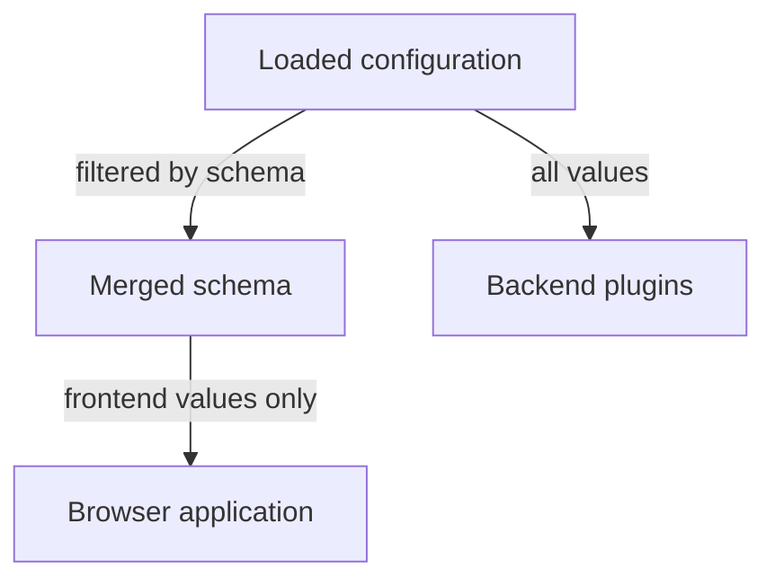

# Visibility: What Reaches The Browser

Backstage is one application with two halves. The backend runs on a server that the operator controls. The frontend is JavaScript that runs inside the browser of every person who opens the portal. Configuration is shared between both halves, so Backstage needs a rule for which values the browser may receive. This chapter explains that rule, the three visibility values and the mistakes that expose a value by accident.

## Backend by default

By default, configuration is available only in the backend. A value that a schema does not mark for the browser never leaves the server. This default protects the operator from the most common failure: someone adds a key to a file, and the key travels to the browser without anyone deciding that it should.

A schema changes the default for one field by adding a `@visibility` annotation in the comment above it. Three values exist:

- `frontend`: the value is visible to the frontend and the backend.
- `backend`: the default. The value is visible only to the backend.
- `secret`: the value is visible only to the backend, and it may also be excluded from logs for security reasons.

The difference between `backend` and `secret` is intent. Both stay on the server. The `secret` value says that the content is sensitive, so tools that print or log configuration can leave it out.

```ts
export interface Config {
  app: {
    /** @visibility frontend */
    title: string;
  };
  integrations?: {
    github?: Array<{
      host: string;
      /** @visibility secret */
      token?: string;
    }>;
  };
}
```

In this schema the title is published to the browser, and the token of a GitHub integration is a secret that stays on the server.

## How far an annotation reaches

The annotation `@visibility` applies only to the field that it annotates. A nested object does not inherit it. The annotation `@deepVisibility` applies to the field and to everything below it. A list of strings needs its own form: `@items.visibility frontend` assigns the annotation to the items of a list of primitive values.

```ts
export interface Config {
  app: {
    /** @deepVisibility frontend */
    branding: {
      logoUrl: string;
      colors: { primary: string };
    };
    /** @items.visibility frontend */
    supportLinks: string[];
  };
}
```

Here every key below `branding` is visible to the browser, and the items of `supportLinks` are too. Without `@deepVisibility`, the nested keys `logoUrl` and `primary` would need an annotation each.

## Conflicts

Schemas from many packages are merged. If two schemas give one key different visibility, for example one says `frontend` and another says `secret`, the merge fails with an error. This is a protection: Backstage does not guess whether a value that one package calls secret may be published by another package.

## What the browser receives

The frontend does not read the YAML files. When the application is served, Backstage filters the loaded configuration through the merged schema and keeps only the values that have visibility `frontend`. The browser application then reads those values with its configuration API. Everything else, including every `secret` and every unannotated value, is not part of what is delivered.

This has a practical meaning for an operator. Whatever is `frontend` can be read by anybody who can open the portal's address, with the developer tools of the browser, even when the page does not display it. A frontend value is public to the audience of the portal. Never mark a credential, a private address or an internal name as `frontend`.



The diagram shows that the backend receives the full configuration and the browser receives only the filtered part.

## Typical mistakes

The first mistake is to mark a value `frontend` because the browser code needs a related value. The browser needs the address of the backend, which is public by design. It does not need the token that the backend uses to call another service. Keep the token as `secret` and let the backend make the call.

The second mistake is to trust the filter for values that were never meant to be configuration. A secret written in the title or in a support link is a `frontend` value, because the field itself is published. The filter protects by field, not by content.

The third mistake is to read a value in the frontend that the schema did not mark. It is not available there, and the code receives nothing. The fix is a deliberate decision: either the value is public and gets the annotation, or the browser must ask a backend route that returns the safe result.

## Try it in the playground

The playground starts with a leaked token in the mounted file. Read it from the ConfigMap and look at the schema that the integration packages use. First, the token as a plain value in the ConfigMap:

<!-- astrona:playground:renew -->

```sh
kubectl -n backstage get configmap backstage-app-config -o jsonpath='{.data.app-config\.lab\.yaml}'
```

The ConfigMap shows the integration entry with the token text. Anyone who can read ConfigMaps in the namespace can read it. Schema visibility cannot fix that, because visibility controls only what Backstage serves to browsers. Now look for the schema of the integrations package in the image:

```sh
kubectl -n backstage exec deploy/backstage -- find /app/node_modules/@backstage -maxdepth 2 -name config.d.ts -path '*integration*'
```

If the command lists a file, read it and find the annotation above the field `token`. The annotation says `@visibility secret`, so Backstage does not send the token to the browser. The ConfigMap still stores it in plain text.

This difference matters: visibility protects the browser path, and storage protects everything else. A secret needs both.

## What you now know

Configuration is backend-only by default. The `frontend` annotation publishes a value to every visitor, `secret` marks a value as sensitive, and `@deepVisibility` applies a choice to a whole subtree. Visibility does not protect a value in a file or ConfigMap. Where a secret is stored and how it is delivered is a separate decision.

## Common pitfalls

> [!WARNING]
> - Marking a value `frontend` to make the browser work. The browser then publishes it to every visitor.
> - Believing `secret` encrypts anything. It only keeps the value out of the browser payload and may keep it out of logs.
> - Annotating an object and expecting its children to be visible. Use `@deepVisibility` for the subtree.
> - Defining the same key as `frontend` in one package and `secret` in another. The schema merge fails.
