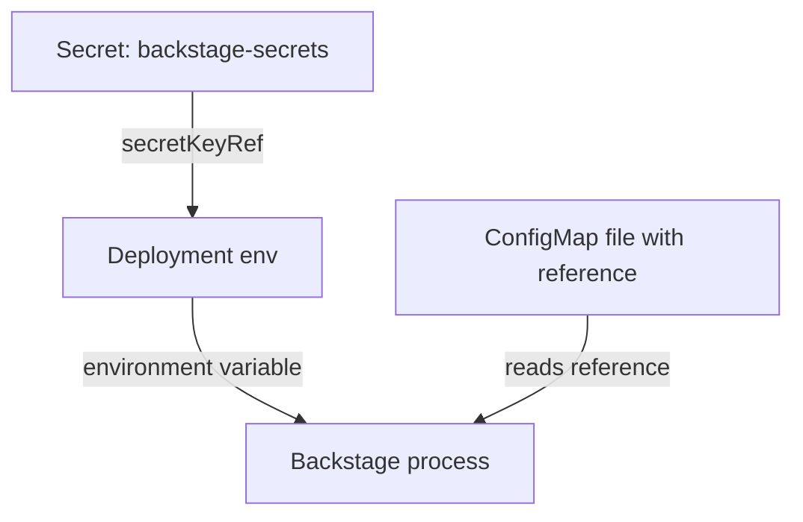

# Secret Delivery And Rotation

A Backstage backend needs credentials: a token for a source code host, a database password, a client secret for sign-in. If those values sit in a file in a repository, everybody with read access to the repository has them. If they sit in a ConfigMap, everybody who can read ConfigMaps in the namespace has them. This chapter shows how the value is kept in a Kubernetes Secret, how it reaches the Backstage process, and what rotation means for a process that reads its configuration only at startup.

## Reference in the file, value in the Secret

The pattern has three parts. The configuration file contains only a reference to the value. A Kubernetes Secret holds the value. The Deployment hands the Secret to the container as an environment variable or as a mounted file, and Backstage resolves the reference when it loads the file.

For a token, the reference is a substitution:

```yaml
integrations:
  github:
    - host: github.com
      token: ${GITHUB_TOKEN}
```

When Backstage loads this file, it replaces `${GITHUB_TOKEN}` with the value of the environment variable `GITHUB_TOKEN` of its own process. The file can be kept in a ConfigMap or a repository, because it contains no secret. The same effect is possible with `$env` for a whole value and with `$file` for a value that is a file, such as one that Kubernetes mounts from a Secret.

## Two ways to deliver a Secret

A Kubernetes Secret reaches a container in two ways. The first is an environment variable, either one key through `valueFrom.secretKeyRef` or all keys through `envFrom.secretRef`. The second is a volume that mounts each key as a file. The first is simpler and fits `${NAME}` and `$env`. The second fits `$file`, and a mounted file is updated by Kubernetes in the pod when the Secret changes, while an environment variable never changes in a running container.

An environment variable has one extra cost: it can appear in the output of tools that print the environment of a process or in a crash report. A file has file permissions. Neither is encrypted inside the pod. The Secret object itself is only base64 encoded in the cluster API, so encryption at rest and access control for Secrets are decisions of the cluster operator.



The diagram shows that the Secret reaches the process through the environment and the ConfigMap file only names the variable.

## Why the value must not be in the file

A secret in a file has three problems that a reference avoids. It is copied wherever the file is copied: version control history, backups, build logs. It is shown in the output of any command that prints the file, including `kubectl get configmap -o yaml`. And a rotation needs a change to the file, which means a review and a deployment of the file instead of an update of one object with narrow access.

Keep one more rule in mind. A reference does not become safe because it is in the file; a value that Backstage prints into a log line or an error message is still printed. The schema marks credential keys with `@visibility secret` so that tools can keep them out of logs, but that protection depends on the code that reads the key.

## Rotation

To rotate a secret means to replace the credential with a new one and stop the old one from working. Four steps are needed for Backstage on Kubernetes. First, create the new credential at the issuer, for example a new token. Second, update the Secret object with the new value. Third, restart the Backstage pods, because the process reads the value at startup and keeps it. Fourth, revoke the old credential at the issuer.

The third step is the one that is forgotten. After the Secret object is updated, the running pod still holds the old value in its environment. A `kubectl rollout restart` replaces the pod, and the new pod starts with the new value. Keep the old credential valid until the new pod is ready, then revoke it, so that the portal has no gap in service.

## Try it in the playground

The ConfigMap in the playground holds a token as plain text. Move it to a Secret. Save this as `secret-backstage-secrets.yaml`. The value is an example and not a real credential:

<!-- astrona:playground:renew -->

```yaml
apiVersion: v1
kind: Secret
metadata:
  name: backstage-secrets
  namespace: backstage
type: Opaque
stringData:
  GITHUB_TOKEN: ghp_starfleet_example_0001
```

Apply it:

```sh
kubectl apply -f secret-backstage-secrets.yaml
```

Pass the Secret to the container as environment variables. The command adds every key of the Secret as a variable and starts a new pod:

```sh
kubectl -n backstage set env deployment/backstage --from=secret/backstage-secrets
```

Now replace the plain token in the ConfigMap with the reference. Save this as `backstage-app-config.yaml`. It is the whole ConfigMap again:

```yaml
apiVersion: v1
kind: ConfigMap
metadata:
  name: backstage-app-config
  namespace: backstage
data:
  app-config.lab.yaml: |
    app:
      title: Starfleet Portal
      baseUrl: http://localhost:7007
    organization:
      name: Starfleet
    backend:
      baseUrl: http://localhost:7007
      listen:
        port: 7007
      cors:
        origin: http://localhost:7007
      database:
        client: better-sqlite3
        connection: ':memory:'
    integrations:
      github:
        - host: github.com
          token: ${GITHUB_TOKEN}
```

Apply it and restart the pod so that the process loads the new file:

```sh
kubectl apply -f backstage-app-config.yaml
kubectl -n backstage rollout restart deployment/backstage
kubectl -n backstage rollout status deployment/backstage --timeout=300s
```

Then check the result. The ConfigMap must now show the reference and no token text, and the pod must have the variable:

```sh
kubectl -n backstage get configmap backstage-app-config -o jsonpath='{.data.app-config\.lab\.yaml}'
kubectl -n backstage exec deploy/backstage -- printenv GITHUB_TOKEN
```

To rotate, change the value in the Secret, restart the pod and read the variable again. The variable keeps the old value until the new pod starts. You can change the value in place with this command:

```sh
kubectl -n backstage patch secret backstage-secrets -p '{"stringData":{"GITHUB_TOKEN":"ghp_starfleet_example_0002"}}'
kubectl -n backstage rollout restart deployment/backstage
```

## What you now know

A secret belongs in a Kubernetes Secret object, the configuration file holds a reference such as `${GITHUB_TOKEN}`, and the Deployment connects the two. A rotation updates the Secret, restarts the pods and revokes the old credential. The Secret object is still only encoded and not encrypted by default, so access to it needs its own controls.

## Common pitfalls

> [!WARNING]
> - Updating a Secret and expecting the running Backstage to use it. The environment of a running container does not change. Restart the pods.
> - Leaving the old token in the ConfigMap after adding the reference. The history of the ConfigMap and any copy still contain it, and the leaked token must be revoked.
> - Referencing `${GITHUB_TOKEN}` without defining the variable in the Deployment.
> - Treating a Secret as encrypted. It is base64 text unless the cluster encrypts it at rest.
