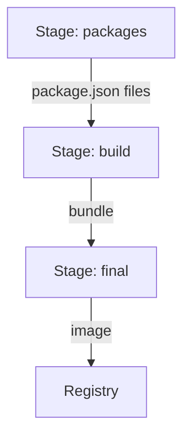

# Building The Backstage Image

A Backstage portal is not installed from a package. An organization keeps its own Backstage application in a source repository, builds it, and runs the result. To run it on Kubernetes or any other platform, the application must be packaged as a container image. This part explains how that image is built, what is inside it, and which parts of the build the organization controls.

## The application is a repository, not a product

A Backstage application is a Yarn workspace, which is one repository that holds several packages. Two of them matter here. The `app` package is the frontend, a browser application that is compiled into static files. The `backend` package is a Node.js process that serves the application programming interfaces (APIs) and, in the standard setup, also serves the compiled frontend files.

The organization chooses the plugins that go into these two packages. That choice is made at build time, in the source code. The running container cannot add a plugin later by changing its configuration. If the organization wants a new plugin, it changes the repository, builds a new image and releases it.

This is the first production fact: the image is the unit of release. Everything that must be present when the process starts, including the code of every plugin, is inside the image. Settings that differ between environments, such as addresses and passwords, stay outside the image and are supplied when the container starts.

## Host build

The official documentation recommends a host build. A host build runs the build steps on the machine that builds the image, for example a continuous integration (CI) worker, and then copies the results into a small Dockerfile. The documented steps run from the repository root:

```sh
yarn install --immutable
yarn tsc
yarn build:backend
```

`yarn install --immutable` installs the dependencies exactly as recorded in `yarn.lock` and fails if the lock file would change. That makes two builds of the same commit use the same dependency versions. `yarn tsc` runs the TypeScript compiler to generate the type definitions. `yarn build:backend` bundles the backend into `packages/backend/dist`.

The documentation advises that the Node.js version on the build machine matches the Node.js version in the Docker base image. A native dependency that is compiled on one Node.js version can fail to load on another.

The Dockerfile for the host build lives at `packages/backend/Dockerfile`. The image build must use the repository root as its context, because the Dockerfile copies files from several folders:

```sh
docker image build . -f packages/backend/Dockerfile --tag backstage
```

The documented Dockerfile starts from the base image `node:24-trixie-slim`. It installs `libsqlite3-dev` so that the SQLite driver works, and the documentation says this can be skipped if SQLite is not used. It runs as the non-root user `node`, sets the working directory to `/app`, and sets `NODE_ENV=production`.

## What the Dockerfile copies

The Dockerfile copies the files that the running process needs and extracts two archives that the build produced. The documented list is:

- `.yarn`, `.yarnrc.yml`, `backstage.json`, `yarn.lock` and `package.json`, which describe the workspace and its dependencies.
- `skeleton.tar.gz`, which holds the `package.json` files of every package. It lets Docker install the production dependencies in a layer that changes only when the dependencies change.
- `bundle.tar.gz`, which holds the built backend.
- The `examples` folder and every `app-config*.yaml` file.

The last item matters for configuration. The image contains the configuration files that were in the repository at build time. The documented start command loads two of them:

```text
node packages/backend --config app-config.yaml --config app-config.production.yaml
```

The first `--config` file is the base configuration. The second is loaded after it and overrides it. A production deployment usually adds a third source after these two, for example a file from a ConfigMap, or environment variables, so that environment values stay out of the image.

## Multi-stage build

The second documented method is a multi-stage build. It runs every step inside Docker, in three stages. This helps when the CI system cannot run Docker commands inside a build, or when the team wants the whole build to be one `docker image build` command.

The first stage, `packages`, collects only the `package.json` files so that the dependency install can be cached. The second stage, `build`, installs the dependencies, runs `yarn tsc` and builds the backend. The final stage assembles the production image with only the production dependencies. The build tools and the source code do not reach the final image.



The diagram shows that only the bundle and the production dependencies move from the build stage into the final image. The command for a multi-stage build is:

```sh
docker image build -t backstage .
```

The two methods produce the same kind of image. A host build is faster and caches better. A multi-stage build needs nothing on the build machine except Docker. The multi-stage method uses a different `.dockerignore` file, because it needs the source code inside the build context.

## Look inside a running image

The playground for this module runs the public Backstage image. The Backstage project publishes it as `ghcr.io/backstage/backstage`. A production release builds its own image instead, but this one shows what a built application contains.

<!-- astrona:playground:renew -->

List the working directory of the container. The `exec` command runs a program inside the running container of the `backstage` Deployment:

```sh
kubectl -n backstage exec deploy/backstage -- ls /app
```

The command prints the files and folders in `/app`. Look for the `packages` folder, the `app-config` files and the `node_modules` folder. They show the layout from the Dockerfile above: the workspace files, the extracted bundle and the installed production dependencies.

Print the base configuration that the image carries:

```sh
kubectl -n backstage exec deploy/backstage -- cat /app/app-config.yaml
```

Find the `backend.database` block in it. The playground does not use this block, because the ConfigMap of the playground is loaded after it and replaces the database settings. This is configuration merging in practice: the image carries a default, and the deployment overrides it.

Check which user the process runs as:

```sh
kubectl -n backstage exec deploy/backstage -- id
```

The documented Dockerfile switches to the user `node`, so the command shows a user that is not `root`. A non-root user limits what a compromised process can change inside the container.

## What the image must not contain

Because the image contains every `app-config*.yaml` file from the repository, any secret written into those files is copied into the image. Anyone who can pull the image can read it. Passwords, tokens and private keys belong in the runtime environment. The configuration files in the image should contain only substitutions such as `${POSTGRES_PASSWORD}`, and the value comes from a Kubernetes Secret when the container starts.

The `.dockerignore` file excludes `.git`, `node_modules` and `*.local.yaml` for the host build. Excluding `*.local.yaml` keeps developer-only overrides out of the image. The same documentation lists the prerequisites for a container: an authentication provider that works in a container, because the guest provider is not suited to it, and a PostgreSQL database.

The image build ended with a runnable artifact. The next question is where the application keeps its data, because the default database inside the image does not survive a restart.

## Common pitfalls

> [!WARNING]
> - A host build needs the same Node.js version as the base image. A mismatch can break native modules at start-up, not at build time.
> - The build context must be the repository root. Building from `packages/backend` leaves out the files that the Dockerfile copies.
> - Secrets in an `app-config*.yaml` file become part of the image. Use `${VARIABLE}` substitutions and supply the value at run time.
> - The public image carries only the plugins that the Backstage project chose. A production release builds its own image with the plugins the organization chose.
