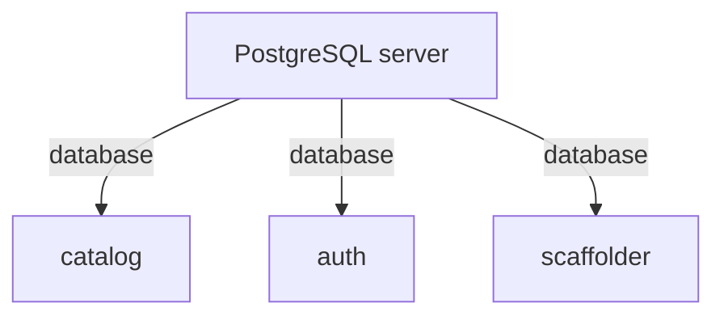

# PostgreSQL And Plugin Databases

A Backstage backend stores its state in a database. Without any configuration, the backend uses a database that lives only in the memory of the process. That is useful on a developer laptop and wrong in production. This part shows what the default loses, how to switch to PostgreSQL, and how Backstage divides one PostgreSQL server between its plugins.

## What the default database loses

When `backend.database` is not set, each backend plugin receives a simple in-memory SQLite 3 database. The documentation states that its contents are lost when the service restarts. SQLite is an embedded database engine: it runs inside the Node.js process and stores its tables in the memory of that process.

Two consequences follow. First, every restart of the pod starts with an empty database, so the catalog has to be built again from its sources. Second, two replicas of the backend do not share data, because each process has its own memory. A request that reaches the first replica can see different data from a request that reaches the second.

The configuration of the playground sets the same default explicitly:

```yaml
backend:
  database:
    client: better-sqlite3
    connection: ':memory:'
```

`client` names the database driver and `connection` tells it where the data lives. The value `':memory:'` is the SQLite name for a database in memory.

## The PostgreSQL configuration

For production, the documentation switches the client to `pg`, which is the PostgreSQL driver. The documented block is:

```yaml
backend:
  database:
    client: pg
    connection:
      host: ${POSTGRES_HOST}
      port: ${POSTGRES_PORT}
      user: ${POSTGRES_USER}
      password: ${POSTGRES_PASSWORD}
```

The text `${POSTGRES_HOST}` is a substitution. When the backend reads the configuration, it replaces the text with the value of the environment variable of that name. The configuration file carries no address and no password. The same file works in every environment, and each environment supplies its own values.

The documentation also names the `PGSSLMODE` environment variable, which sets the `sslmode` connection option. A database outside the cluster usually needs encrypted connections, and this variable is one way to request them.

## One database for each plugin

A Backstage backend is made of plugins, for example the catalog and the scaffolder. The documentation states that by default each plugin gets its own logical database on the PostgreSQL server. The setting that controls this is `pluginDivisionMode`. Its default value is `database`.

Setting `pluginDivisionMode: schema` changes the layout. The plugins then share one database and each plugin gets its own schema, which is a named group of tables inside a database. An optional `schemaPrefix` is put in front of the schema name, and the documentation says the combined schema name must not exceed 63 bytes.



The diagram shows the default layout: one server, one database for each plugin. The separation gives each plugin its own tables, and a plugin cannot read the tables of another plugin by accident. The plugins that appear depend on the plugins in the image.

Pool settings are the one per-plugin override that the database service documents. The documentation shows that connection pool settings can be overridden for one plugin under `backend.database.plugin.<pluginId>.knexConfig`. Knex is the database library that Backstage uses.

## Switch the playground to PostgreSQL

The playground already runs a PostgreSQL server as the Service `postgres`. Its credentials are in the Secret `postgres-secrets`, with the keys `POSTGRES_USER` and `POSTGRES_PASSWORD`.

<!-- astrona:playground:renew -->

First, save the new configuration as `backstage-app-config.yaml`. It is the ConfigMap with the PostgreSQL block:

```yaml
apiVersion: v1
kind: ConfigMap
metadata:
  name: backstage-app-config
  namespace: backstage
data:
  app-config.lab.yaml: |
    app:
      title: Starfleet Portal
      baseUrl: http://localhost:7007
    organization:
      name: Starfleet
    backend:
      baseUrl: http://localhost:7007
      listen:
        port: 7007
      cors:
        origin: http://localhost:7007
      database:
        client: pg
        connection:
          host: ${POSTGRES_HOST}
          port: ${POSTGRES_PORT}
          user: ${POSTGRES_USER}
          password: ${POSTGRES_PASSWORD}
```

Apply it:

```sh
kubectl apply -f backstage-app-config.yaml
```

The ConfigMap now names the variables, but the container does not have them yet. Save this as `backstage-database-patch.yaml`. It loads the Secret as environment variables and sets the host and port:

```yaml
spec:
  template:
    spec:
      containers:
        - name: backstage
          envFrom:
            - secretRef:
                name: postgres-secrets
          env:
            - name: POSTGRES_HOST
              value: postgres
            - name: POSTGRES_PORT
              value: "5432"
```

Apply it and wait for the new pod:

```sh
kubectl -n backstage patch deployment backstage --patch-file backstage-database-patch.yaml
kubectl -n backstage rollout status deployment/backstage --timeout=300s
```

The patch changes the pod template, so Kubernetes starts a new pod. That is needed here because Backstage reads its configuration when it starts, and the running pod would keep its old settings.

The reason `POSTGRES_PORT` is set explicitly is a Kubernetes behavior. For every Service in the namespace, Kubernetes adds environment variables to new pods, and for a Service named `postgres` one of them is named `POSTGRES_PORT` with a value that starts with `tcp://`. A variable declared in the container overrides it, so the explicit value `5432` is the safe choice.

Read the start-up log of the new pod:

```sh
kubectl -n backstage logs deploy/backstage
```

Look for lines that mention the database. A wrong password or host produces a connection error there, and the pod does not become ready.

## What PostgreSQL holds after the switch

List the databases on the server:

```sh
kubectl -n backstage exec deploy/postgres -- psql -U backstage -c '\l'
```

Write down the names. They show how plugin databases are named on this server. This course does not state the names, because they depend on the plugins in the image and the version. Delete the Backstage pod and wait for the replacement. The catalog data is now in PostgreSQL, so the replacement pod uses the same databases instead of starting from nothing.

The data survives only as long as PostgreSQL does. In the playground, the PostgreSQL data directory is on a PersistentVolumeClaim, so deleting the PostgreSQL pod does not delete the data. The next part explains who owns that data and what has to happen to it over time.

## Common pitfalls

> [!WARNING]
> - A password written into the ConfigMap is stored in plain text and readable by everyone who can read ConfigMaps. Keep it in a Secret and use `${POSTGRES_PASSWORD}`.
> - Changing the ConfigMap does not change the environment of a running pod. A configuration that names new variables needs a pod that has them, so roll out the Deployment.
> - Kubernetes adds service environment variables such as `POSTGRES_PORT` to pods. Set `POSTGRES_PORT` explicitly so the value is a number.
> - Two replicas on the in-memory SQLite database each hold their own data. Use PostgreSQL before you run more than one replica.
