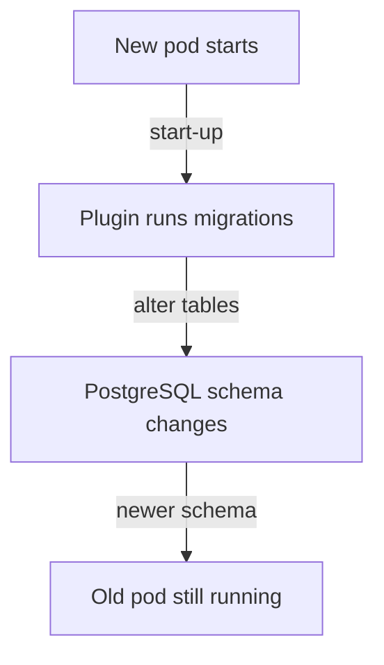

# Migrations, Backups And Data Ownership

Once Backstage stores its data in PostgreSQL, three questions remain that the container image cannot answer. Who changes the table layout when the application is upgraded? Who makes sure the data can be restored? Who owns the database server? This part answers each question and shows a backup taken from the playground.

## Who changes the tables

A database schema is the set of tables and columns that a program expects. A new version of a plugin can need a different schema than the old version. The change from one schema to the next is called a migration, and it is a script that creates or alters tables.

The backend database service documentation shows where the migrations of a plugin run. In its example, the plugin gets a database client when it starts and calls `client.migrate.latest(...)` with the folder that holds its migration files. The same example skips the migration when a configuration option for skipping migrations is set. The migration is therefore code inside the plugin, and it runs in the backend process during start-up.

This has three practical consequences for a release:

- The new pod migrates the database as it starts. The database changes before the pod is ready, so a pod that reports ready has normally finished the migrations of its plugins.
- The old pod, if it still runs during a rolling release, is now talking to a database that a newer plugin version changed. An old version can be unable to work with a newer schema.
- Rolling back the image does not roll back the database. The older image starts against the newer schema, and whether it works depends on the migration.



The diagram shows why a database change reaches the old pod before the old pod is removed. The release procedure of the next module keeps this in mind: a release that changes the schema is not freely reversible.

## What Backstage does not do

Backstage does not take backups. It does not copy the database to another place, and it does not restore data. The migration code changes tables forward, and nothing in the application brings back a deleted table or a lost disk.

The catalog gives a useful example of how data differs. The catalog entities come from source files in repositories, which the catalog reads from the locations that the configuration names. If the catalog tables are lost, the catalog can read the sources again, but the processing takes time and any data that was written only to the database is gone. Other plugins can hold data that exists nowhere else. The plugin documentation decides which kind a plugin has, so a recovery plan lists the plugins in the image and what each one stores.

For that reason, the organization that runs the portal owns the database as a service. It owns four tasks:

- Persistent storage. The server needs disks that survive a pod or a node being replaced.
- Backups. A scheduled copy of the databases, stored somewhere else, and a tested way to restore it.
- Access. Who can connect, with which user, from which network, and with encryption when the server is outside the cluster.
- Capacity and upgrades. Disk space, connection limits and PostgreSQL version upgrades.

Many organizations use a managed PostgreSQL service for this, because the provider covers storage, backups and upgrades. The playground runs PostgreSQL in the cluster instead, on a PersistentVolumeClaim, which is a request for storage that outlives a pod.

## Persistent storage in the playground

In the playground, the `postgres` Deployment mounts the claim `postgres-data` at `/var/lib/postgresql/data` and sets `PGDATA` to a folder inside it. The Deployment uses the `Recreate` strategy, which stops the old pod before it starts the new one. A PostgreSQL data directory must not be opened by two server processes at the same time, so two pods must never run against one claim.

<!-- astrona:playground:renew -->

Check that the claim is bound to a volume:

```sh
kubectl -n backstage get pvc postgres-data
```

The `STATUS` column must show `Bound`. A claim that stays `Pending` means that no storage was provided, and the PostgreSQL pod cannot start.

Delete the PostgreSQL pod and wait for the Deployment to create a new one:

```sh
kubectl -n backstage delete pod -l app=postgres
kubectl -n backstage rollout status deployment/postgres --timeout=300s
```

The Deployment starts a new pod that mounts the same claim, so the databases that existed before are still there. Run the database list again:

```sh
kubectl -n backstage exec deploy/postgres -- psql -U backstage -c '\l'
```

The list is the same as before the pod was deleted. The data lived on the claim and not in the pod.

A claim protects against the loss of a pod. It does not protect against deleting the claim, a failed disk or an application bug that writes wrong data. Only a separate copy protects against those.

## Take a backup

PostgreSQL ships `pg_dumpall`, which writes the SQL statements that recreate every database and role of the server. Run it inside the PostgreSQL pod and write its output to a file on your machine:

```sh
kubectl -n backstage exec deploy/postgres -- pg_dumpall -U backstage > backstage-backup.sql
```

The redirect `>` runs on your machine and writes the output of the remote command into `backstage-backup.sql`. Check that the file has content:

```sh
wc -l backstage-backup.sql
```

A file with zero lines means that the dump failed. Read the error text on the terminal in that case.

A backup is useful only if you can restore it. A restore replays the SQL into an empty server, and it should be tested on a separate server before the day it is needed. The test also shows how long the restore takes, which is the downtime the organization must plan for.

## Common pitfalls

> [!WARNING]
> - A migration runs in the new pod before the new pod is ready. During a rolling release, the old pod can face a schema that a newer plugin already changed.
> - Rolling back the image does not roll back the database. Take a backup before a release that upgrades the plugins.
> - A PersistentVolumeClaim keeps data when a pod is replaced. It is not a backup.
> - Never run two PostgreSQL pods against one data directory. The `Recreate` strategy prevents it.
