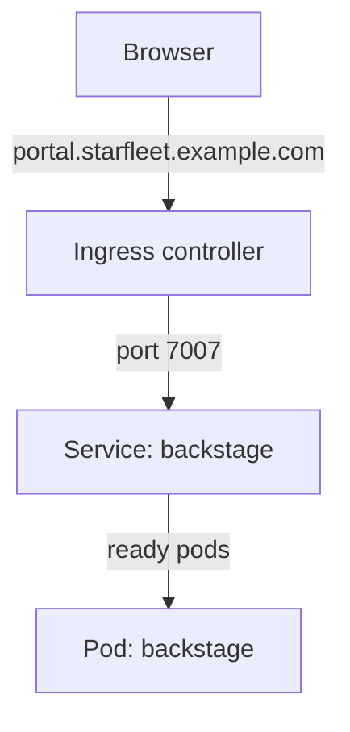

# Deployment, Service, Ingress And Base URLs

Running Backstage on Kubernetes needs three objects that work together: a Deployment that runs the pods, a Service that gives them a stable address inside the cluster, and an Ingress that publishes that address outside it. Backstage adds a fourth requirement of its own: its configuration must know the address that users type in the browser. This part explains how the four fit together and what breaks when they disagree.

## The Deployment

A Deployment is a Kubernetes object that keeps a set of identical pods running and replaces them when their definition changes. The official Kubernetes guide for Backstage uses one Deployment named `backstage` in the namespace `backstage`, with one container, one replica and the container port 7007. The container port is named `http`, so other objects can refer to the name instead of the number.

The pod template of the playground Deployment contains the parts that matter:

- `image: ghcr.io/backstage/backstage:1.55.2` selects the version of the application. A fixed tag makes a release repeatable, and a tag such as `latest` can change under a running Deployment.
- `command` and `args` start `node packages/backend` with two `--config` files. The second one is mounted from a ConfigMap.
- `ports` declares 7007, the port on which the backend listens.
- `volumeMounts` and `volumes` put the ConfigMap into the container at `/etc/backstage`.

The `selector` of the Deployment must match the labels of the pod template. The Service later uses the same labels to find the pods.

## The Service

A Service is a Kubernetes object that gives a set of pods one stable name and virtual address, and sends each connection to one of the ready pods behind it. Pods come and go during a release, and their addresses change. The Service address does not.

The official guide defines a Service named `backstage` that listens on port 80 and sends traffic to the container port named `http`. The playground uses the same pattern with port 7007:

```yaml
apiVersion: v1
kind: Service
metadata:
  name: backstage
  namespace: backstage
spec:
  selector:
    app: backstage
  ports:
    - name: http
      port: 7007
      targetPort: http
```

`selector` chooses the pods by label. `port` is the port of the Service, and `targetPort` is the port of the container. The Service sends traffic only to pods that report ready. A pod that fails its readiness check is removed from the list of endpoints, which is the mechanism that makes a release safe. The next part shows how the readiness check works.

## The Ingress

An Ingress is a Kubernetes object that describes how requests from outside the cluster reach a Service, usually by host name and path. An Ingress does nothing by itself. An ingress controller, which is a separate program in the cluster, reads Ingress objects and configures a proxy. A cluster without a controller accepts an Ingress object and routes nothing.

Save this as `ingress-backstage.yaml`:

```yaml
apiVersion: networking.k8s.io/v1
kind: Ingress
metadata:
  name: backstage
  namespace: backstage
spec:
  rules:
    - host: portal.starfleet.example.com
      http:
        paths:
          - path: /
            pathType: Prefix
            backend:
              service:
                name: backstage
                port:
                  number: 7007
```

The rule sends every request for the host `portal.starfleet.example.com` to the Service `backstage` on port 7007. The Backstage backend serves both the API and, in the standard setup, the frontend files. The documentation also describes serving the frontend separately, from a static file server, after removing the `app-backend` plugin. In that layout, the Ingress needs a second path for the API.



The diagram shows the path of one request: the controller applies the Ingress rule, the Service selects a ready pod, and the pod answers.

## Base URLs must match the browser

Backstage needs to know its own public address. The configuration has three settings for this: `app.baseUrl`, `backend.baseUrl` and `backend.cors.origin`. `app.baseUrl` is the address of the frontend. `backend.baseUrl` is the address at which browsers reach the backend. `backend.cors.origin` is the origin that the backend allows for cross-origin requests from the browser. An origin is the combination of scheme, host and port.

The official guide says that `app.baseUrl` and `backend.baseUrl` should match the forwarded address, and it sets `backend.listen.port` to 7007 and the CORS origin to the same address. The point is that these values describe the outside, not the inside. `backend.listen.port` is the port the process opens inside the container. The base URLs are what the user sees in the address bar.

The consequence for an Ingress with a host name is that all three values must be the public address:

```yaml
app:
  baseUrl: https://portal.starfleet.example.com
backend:
  baseUrl: https://portal.starfleet.example.com
  cors:
    origin: https://portal.starfleet.example.com
```

If they still say `http://localhost:7007`, the page can load, because the Ingress delivers the frontend files. The frontend then reads the backend address from its configuration, sends its API requests to `localhost` on the user's own computer, and fails. The failure shows up in the browser, while every Kubernetes object looks healthy.

## Look at the objects in the playground

The playground starts with the Service but without an Ingress, and its base URLs are `http://localhost:7007`, which matches the port forward that the playground opens.

<!-- astrona:playground:renew -->

List the Service and the pods that stand behind it:

```sh
kubectl -n backstage get service backstage
kubectl -n backstage get endpoints backstage
```

The second command lists the addresses of the ready pods. An empty list means that no pod is ready, so the Service has nowhere to send traffic.

Send a request to the Service from inside the cluster. The command starts a temporary pod with the `curl` tool and deletes it afterwards:

```sh
kubectl -n backstage run curl-check --rm -it --restart=Never --image=curlimages/curl:8.22.0 --command -- curl -s -o /dev/null -w '%{http_code}\n' http://backstage:7007/
```

The output is the HTTP status code of the answer. The name `backstage` resolves inside the namespace to the Service address.

Apply the Ingress file. The playground has no ingress controller, so the object is stored and routes nothing:

```sh
kubectl apply -f ingress-backstage.yaml
kubectl -n backstage get ingress backstage
```

Reading the object back shows the host and the rule. Routing real traffic needs a controller and a DNS record for the host name.

## Common pitfalls

> [!WARNING]
> - An Ingress without an ingress controller is accepted and does nothing.
> - `app.baseUrl`, `backend.baseUrl` and `backend.cors.origin` describe the public address. Leaving `localhost` in them breaks the page in the browser even though every pod is healthy.
> - The `targetPort` of the Service must match the container port or its name. A wrong value gives a Service with endpoints that refuse connections.
> - The labels in `selector` of the Service must match the pod labels, or the endpoint list stays empty.
