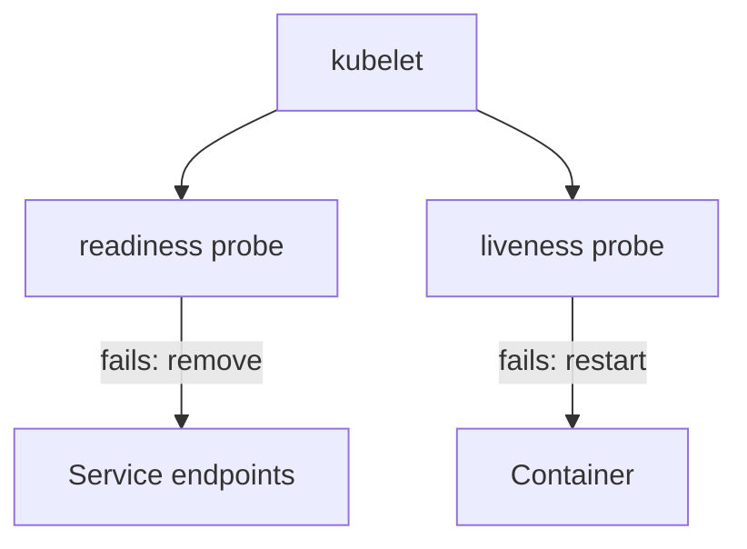

# Secrets And Health Probes

A production Backstage deployment must hold credentials without exposing them, and it must tell Kubernetes whether each pod is able to serve traffic. This part covers both. It shows how a Kubernetes Secret reaches the configuration, and how the two health endpoints of the backend feed the readiness and liveness probes.

## Secrets reach the process as environment variables

A Kubernetes Secret is an object that stores small pieces of sensitive data, such as a token or a password, separately from the pod definition. The data is encoded with base64. Base64 is an encoding, not encryption: anyone who can read the Secret object can decode it. Access to Secrets is controlled with Kubernetes role-based access control, and a cluster can also encrypt Secrets at rest.

The official Backstage guide passes credentials to the container with `envFrom`, which loads every key of a Secret as an environment variable of the container. It references two Secrets: `postgres-secrets` for the database user and password, and `backstage-secrets` for a GitHub token.

Save this as `backstage-secrets.yaml`:

```yaml
apiVersion: v1
kind: Secret
metadata:
  name: backstage-secrets
  namespace: backstage
type: Opaque
stringData:
  GITHUB_TOKEN: ghp_labtokenvalue0000
```

`stringData` lets you write the value as plain text in the file, and Kubernetes stores it base64 encoded under `data`. The value in this file is a made-up example. A real token must never be committed to a repository together with the manifest.

In the Deployment, the container then contains:

```yaml
envFrom:
  - secretRef:
      name: backstage-secrets
```

The configuration reads a value with the substitution `${GITHUB_TOKEN}`. The configuration file in the ConfigMap holds only the variable name, and the Secret holds the value. Neither the image nor the ConfigMap contains the token.

## What a Secret change does

Kubernetes sets the environment variables of a container when the container starts. If the value of a Secret changes later, the running process keeps the old value. A rotation of a credential, which means replacing it with a new one, therefore needs a new pod. The usual way is to start a rollout of the Deployment after the Secret changed:

```sh
kubectl -n backstage rollout restart deployment/backstage
```

The same applies to the ConfigMap. Backstage reads its configuration when it starts, so a changed ConfigMap needs a restart as well.

## Health endpoints

The Backstage backend exposes two health endpoints through its root HTTP router, and they are enabled by default. The documentation names them:

- `/.backstage/health/v1/liveness`
- `/.backstage/health/v1/readiness`

Both return a JSON object with the status of the backend services. The two paths answer two different questions, and Kubernetes uses two different probes to ask them. A probe is a check that the kubelet, the agent on each node, runs against a container.

A readiness probe answers the question: should this pod receive traffic now? When the probe fails, Kubernetes keeps the pod running and removes it from the endpoints of the Service. When it passes again, the pod is added back. A liveness probe answers the question: is this process still working? When the probe fails repeatedly, the kubelet kills the container and starts it again.



The diagram shows the two different reactions. A failed readiness probe only changes where traffic goes. A failed liveness probe restarts the process.

## The probes in the Deployment

The two probes use `httpGet`, which sends an HTTP request and treats a successful status code as a pass. Save this as `backstage-probes-patch.yaml`:

```yaml
spec:
  template:
    spec:
      containers:
        - name: backstage
          readinessProbe:
            httpGet:
              path: /.backstage/health/v1/readiness
              port: http
            initialDelaySeconds: 20
            periodSeconds: 5
          livenessProbe:
            httpGet:
              path: /.backstage/health/v1/liveness
              port: http
            initialDelaySeconds: 60
            periodSeconds: 10
```

`port: http` refers to the container port by name. `initialDelaySeconds` is the time that the kubelet waits after the container starts before the first check, and `periodSeconds` is the time between checks. The values here are estimates for a small cluster. Backstage compiles nothing at start, but it loads plugins and runs migrations, which takes time. The liveness delay is longer than the readiness delay on purpose. A liveness probe that starts too early restarts a pod that was only still starting, and the pod never finishes starting.

## Try the endpoints and the probes

<!-- astrona:playground:renew -->

Send requests to both endpoints from a temporary pod in the cluster:

```sh
kubectl -n backstage run curl-check --rm -it --restart=Never --image=curlimages/curl:8.22.0 --command -- curl -s -i http://backstage:7007/.backstage/health/v1/readiness
kubectl -n backstage run curl-check --rm -it --restart=Never --image=curlimages/curl:8.22.0 --command -- curl -s -i http://backstage:7007/.backstage/health/v1/liveness
```

The option `-i` prints the status line and the headers before the body. Write down the status codes and the JSON bodies. The playground Deployment has no probes yet, so Kubernetes currently treats a started container as ready.

Create the Secret and apply the probes:

```sh
kubectl apply -f backstage-secrets.yaml
kubectl -n backstage patch deployment backstage --patch-file backstage-probes-patch.yaml
kubectl -n backstage rollout status deployment/backstage --timeout=300s
```

Look at the probe settings that Kubernetes recorded:

```sh
kubectl -n backstage describe deployment backstage
```

Find the lines `Liveness:` and `Readiness:`. They show the path, the port and the timing that you set. During the rollout, run `kubectl -n backstage get pods` in another terminal and notice that the new pod shows `0/1` in the `READY` column until the readiness probe passes.

## What a probe does not prove

A probe proves what its endpoint reports. The backend health endpoints describe the state of the backend services. They do not call every integration, and they do not prove that the catalog has data. A pod can be ready while one feature is broken, for example because a token expired. A probe that checks too much has the opposite problem: if the readiness endpoint depended on an external system, an outage of that system would remove every pod from the Service at once.

## Common pitfalls

> [!WARNING]
> - A Secret is base64 encoded, not encrypted. Restrict who can read it.
> - Changing a Secret or a ConfigMap does not change a running pod. Restart the Deployment.
> - A liveness probe with a short `initialDelaySeconds` restarts a pod that is still starting.
> - A wrong probe path makes the pod `0/1` ready forever, or restarts it repeatedly. Check the path against the documented endpoints.
