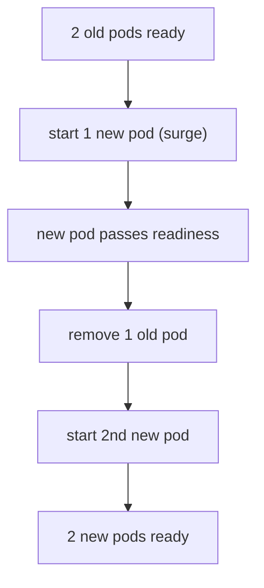

# Rolling Releases And Feature Health

A release replaces running pods with new ones. This part explains how a Deployment does that without downtime, how the replica count and the rollout settings interact, how to go back to the previous version, and why a green rollout does not prove that every feature of the portal works.

## How a rolling update works

A Deployment manages ReplicaSets. A ReplicaSet keeps a fixed number of identical pods running. When the pod template of a Deployment changes, for example a new image tag, a new environment variable or a new probe, the Deployment creates a new ReplicaSet and moves pods from the old ReplicaSet to the new one in steps. This is the default `RollingUpdate` strategy.

Two settings control the size of each step:

- `maxSurge` is how many pods above the desired replica count may exist during the update.
- `maxUnavailable` is how many pods below the desired count may be unavailable during the update.

Both accept a number or a percentage. With `replicas: 2`, `maxSurge: 1` and `maxUnavailable: 0`, the Deployment starts one new pod first, waits until it is ready, then removes one old pod, and repeats. At no moment are fewer than two pods ready.



The diagram shows why readiness probes matter for releases. The Deployment decides that a new pod is available only when its readiness probe passes. Without a readiness probe, a pod counts as ready as soon as its container starts, and the old pods can be removed while Backstage is still loading plugins.

## The release settings in a manifest

Save this as `backstage-rollout-patch.yaml`:

```yaml
spec:
  replicas: 2
  strategy:
    type: RollingUpdate
    rollingUpdate:
      maxSurge: 1
      maxUnavailable: 0
```

The default values are 25 percent for both settings, which are rounded in a way that depends on the replica count. Setting `maxUnavailable: 0` is a deliberate choice: capacity is never reduced during a release, and the cost is that the cluster needs room for one extra pod.

## Replicas and the database

Running two replicas of Backstage is only safe when all replicas share one database. With the default in-memory SQLite, every pod has its own private database. Two replicas then hold two different sets of data, and a request is answered by whichever pod the Service chooses. A shared PostgreSQL database is what makes several replicas meaningful. If the configuration still uses SQLite, keep one replica.

A second point is that the PostgreSQL Deployment itself uses the `Recreate` strategy with one replica and a single PersistentVolumeClaim. Two PostgreSQL pods must never write to the same volume at the same time, so the old pod is stopped before the new one starts.

## Try a release and a rollback

<!-- astrona:playground:renew -->

Apply the rollout settings and watch the Deployment:

```sh
kubectl -n backstage patch deployment backstage --patch-file backstage-rollout-patch.yaml
kubectl -n backstage rollout status deployment/backstage --timeout=300s
kubectl -n backstage get pods
```

Now make a change that creates a new revision. A revision is one recorded version of the pod template. Add an annotation to the pod template, which changes the template without changing the application:

```sh
kubectl -n backstage patch deployment backstage --type merge -p '{"spec":{"template":{"metadata":{"annotations":{"lab/release":"two"}}}}}'
kubectl -n backstage rollout status deployment/backstage --timeout=300s
kubectl -n backstage rollout history deployment/backstage
```

`rollout history` lists the revisions. In a second terminal, run `kubectl -n backstage get pods -w` while the rollout runs and observe that a new pod starts before an old one terminates.

Go back to the previous revision:

```sh
kubectl -n backstage rollout undo deployment/backstage
kubectl -n backstage rollout status deployment/backstage --timeout=300s
```

`rollout undo` restores the pod template of the previous revision. It does not restore data. A rollback of the image does not undo a database migration that the newer version already applied, so a release that changes the schema needs a database backup taken before the release.

## Availability is not feature health

A successful rollout means that the pods are ready and the Service has endpoints. The readiness endpoint reports the state of the backend. It does not tell you that the catalog shows the expected entities, that sign-in works, or that a plugin can reach the system it integrates with. A release can pass every probe and still break one feature, for example when a token is missing or the base URL does not match the public address.

Treat the two as separate checks:

- Availability: pods are ready, the Deployment has the desired replicas, requests are answered. Kubernetes measures this.
- Feature health: the functions that users need work. This needs checks of its own, such as a request that reads a known catalog entity after each release.

A simple feature check after a release:

```sh
kubectl -n backstage run curl-check --rm -it --restart=Never --image=curlimages/curl:8.22.0 --command -- curl -s -o /dev/null -w "%{http_code}\n" http://backstage:7007/api/catalog/entities
```

The command prints only the HTTP status code. Whether a status code of 200 or 401 is expected depends on the authentication configuration of the instance, so decide the expected value before the release and compare against it.

## Common pitfalls

> [!WARNING]
> - Without a readiness probe, a rolling update can remove old pods before the new pods can serve requests.
> - Several replicas on in-memory SQLite hold separate data. Use PostgreSQL before raising the replica count.
> - `rollout undo` does not undo database changes. Take a backup before a release that migrates the schema.
> - A finished rollout proves availability only. Check at least one real feature after every release.
