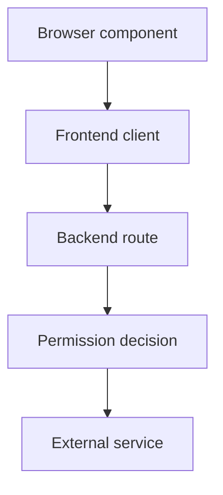

# Browser APIs, Backend Routes And Trust Boundaries

The Backstage frontend is a browser application. It renders pages and plugin components, manages interactive state and calls APIs. The backend runs server-side features such as catalog processing, authentication support and privileged integration requests. Even when both are served from the same deployment, the browser and server remain separate trust and execution boundaries.

A frontend API abstraction gives components a stable way to request information. For example, a deployment card can ask a deployment client for the status associated with an entity. The client resolves the appropriate backend route and handles the response contract. This separation keeps the visual component from embedding assumptions about every deployment address or external credential.

The backend route receives a request and decides how to serve it. It may read its database, call an external service or combine information from several sources. The external service identity belongs to the backend integration and should have limited authority. A browser user does not need that credential merely to see the resulting status. Delivering it to the browser would expose the integration's authority to inspection and reuse.

Discovery, authentication and authorization answer different questions. Discovery identifies where an API is available. Authentication establishes the caller's identity through the application's configured mechanisms. Authorization determines whether that identity may read particular information or perform an action. A correct route address does not grant permission, and a recognized user is not automatically entitled to every operation.

Imagine a portal card with a button to restart a service. Hiding the button from most users improves the interface, but it cannot establish the security policy. A caller can construct the backend request independently. The route must enforce the permitted operation on the server and constrain the target service. Otherwise a user can bypass the visual restriction and exercise the backend's privileged credential.

Response design should distinguish absent data from failed communication. A service without a configured deployment annotation may legitimately have no deployment card. A timeout contacting an external controller is a different state. Returning an empty list for every failure conceals the distinction and can make an operational outage look like a complete absence of software. A useful client contract preserves meaningful errors without exposing confidential server details.

Browser requests also encounter routing and origin constraints. A development frontend may call a backend on a different address, while production routes may pass through a reverse proxy. Allowed origins, externally visible addresses and identity callbacks must be compatible. These issues can prevent requests even when the backend endpoint itself exists. Their diagnosis belongs at the browser-server boundary rather than inside catalog descriptor syntax.

Backend plugins can be deployed together or separated according to the application architecture. Their stable API contracts still matter. Splitting a feature into another deployment requires deliberate discovery, identity and operational configuration. Moving code does not automatically preserve every assumption made by a client or another server feature.

Finally, the interface needs accessible loading and error behavior. A slow integration should not freeze the whole portal or silently display stale information as current. The client can communicate freshness and failure clearly, while the backend records suitable diagnostic evidence. Correlation identifiers can connect a user-visible failure to server evidence without revealing integration credentials.

The browser and server paths remain distinct even when served by one deployment:

The diagram places the privileged external call after the server's permission boundary; a browser visibility decision cannot replace that boundary.

## Common pitfalls

> [!WARNING]
> Frontend visibility is not server authorization. Keep privileged tokens behind backend boundaries and distinguish absent data from failed requests. Discovery supplies an address; identity and permission checks still need their own enforcement.
