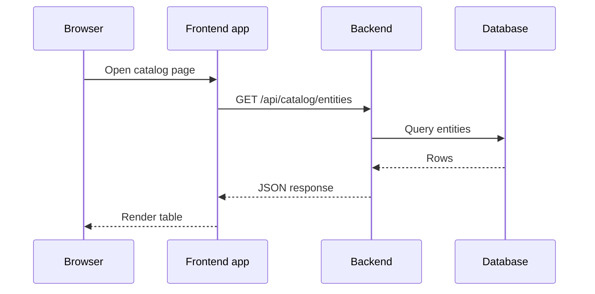

# Browser App, Backend Process And The Request Path

When a user opens the Starfleet portal and sees a list of services, two different programs have worked together. One runs on the user's computer. The other runs on a server that the platform team operates. Many problems with a Backstage installation come from mixing these two up: a setting is changed in the wrong place, a secret is read in the wrong program, or a failing request is blamed on the wrong component. This part separates the two programs and follows one request from the click to the response.

## Two programs, two places

Backstage is a client-server application. The **frontend app** is a single-page application: a bundle of JavaScript, HTML and CSS that the browser downloads and runs. It draws pages, handles clicks and calls APIs (application programming interfaces) over HTTP (Hypertext Transfer Protocol). It does not read a database and it does not talk to GitHub or Kubernetes on its own.

The **backend** is a Node.js process. It runs on a server, here inside a pod in the namespace `backstage`. It loads **backend plugins**, which are packages that add features such as the software catalog, the scaffolder, TechDocs and the permission framework. All backend plugins share one HTTP server, and that server listens on port 7007 by default.

The split follows one rule. The browser is under the control of the person who uses it, so it is not trusted with anything that must stay private. The backend is under the control of the platform team, so it holds credentials, reads the database and calls other systems.

## Pairs of plugins

Most features come in pairs. A **frontend plugin** supplies the pages and components. A **backend plugin** supplies the data and the actions. The catalog is the usual example: the frontend plugin shows the entity table, and the backend plugin stores entities, reads them from the database and answers queries.

The frontend plugin does not know how the backend stores data. It calls an HTTP API of the backend plugin through a small client library. This API is the contract between the two halves. When the contract is respected, the platform team can change how the backend works without touching the browser code.

## Follow one request

Open the catalog page of the portal. The browser has to find out which entities exist, and the path of that question has four steps.



The diagram shows that the frontend app never reaches the database. The request goes to the backend, the backend plugin queries the database and the response travels back as JSON (JavaScript Object Notation).

Note the first line of the request: `GET /api/catalog/entities`. The path starts with `/api`, then the plugin identifier `catalog`, then the route that the plugin defines. Every backend plugin follows this pattern.

## See the two programs in the playground

The playground runs one pod with the official Backstage image. The same process serves two kinds of requests. You can send a request from inside the pod, so you do not depend on any address outside the cluster.

<!-- astrona:playground:renew -->

First print the arguments that start the backend:

```sh
kubectl -n backstage get deployment backstage -o jsonpath='{.spec.template.spec.containers[0].args}'
```

The command prints the argument list of the container. The backend reads each file in that list as a configuration file, in order, and later files win over earlier ones.

Next ask the backend whether it is ready. Backstage exposes a readiness endpoint for this question:

```sh
kubectl -n backstage exec deploy/backstage -- node -e "fetch('http://localhost:7007/.backstage/health/v1/readiness').then(r => console.log(r.status))"
```

The `kubectl exec` command runs the Node.js one-liner inside the container. The one-liner uses the built-in `fetch` function to send a request to the backend on `localhost`, and it prints the HTTP status code. A status in the 200 range means that the backend process answers. The container image is assumed to ship a Node.js version that has `fetch`.

Now ask for catalog data without any credentials:

```sh
kubectl -n backstage exec deploy/backstage -- node -e "fetch('http://localhost:7007/api/catalog/entities').then(r => console.log(r.status))"
```

Compare the status of this request with the readiness request. The two paths reach the same process, but the backend treats them differently, because health endpoints are not plugin data routes. The reasons are the topic of the authentication part of this course; for now, note that the status of the request depends on the route and on the credentials.

## Where configuration is read

Backstage reads YAML (YAML Ain't Markup Language) configuration files when the backend process starts. The files are merged in the order given on the command line. In the playground a ConfigMap mounts the file `app-config.lab.yaml` at `/etc/backstage`, and it is loaded after the `app-config.yaml` that ships in the image.

The frontend app needs some of these values too, for example the address of the backend. The backend does not hand over the whole file. Each configuration key has a **visibility**: `frontend`, `backend` or `secret`. Only keys marked `frontend` reach the browser. The default is `backend`. This design keeps the database settings and tokens out of the browser even though both programs read the same files.

## What the browser sends and receives

The browser sends ordinary HTTP requests. Each request has a method, a path, headers and sometimes a body. Because the frontend app is code that runs on the user's machine, anyone can open the browser developer tools, read the requests and replay them with another tool. For that reason the backend has to check every request. It cannot assume that a request came from the real frontend app.

The response comes as JSON for data routes. The frontend app turns JSON into components. If the backend answers with an error status, the frontend plugin decides how to show it: an error panel, an empty table or a retry. The backend does not draw pages.

## Practical consequences

Knowing the split helps with fault finding. If a page shows no data, check the browser network tab for the failing request and its status. If the status is 401 or 403, look at authentication and permissions. If the request never arrives, look at addresses, CORS (cross-origin resource sharing) and the proxy. If the backend returns 500, read the backend log, because only the backend knows why.

This part separated the browser app from the backend process and followed one request along the path. You now know which program does what. The open question is how the browser finds the backend at all, and which settings define the addresses. The next topic answers that.

## Common pitfalls

> [!WARNING]
> - **Treating the frontend as trusted.** Any user can read and replay the requests of the browser app. The backend must check every request itself.
> - **Putting a secret in a key with `frontend` visibility.** Such a key is sent to every browser. Keep secrets in `backend` or `secret` keys.
> - **Debugging in the wrong program.** A blank page can come from a failing API call, so check the network tab first and the backend log second.
> - **Assuming the app and the backend are one address.** They can be served from the same address or from two. Read the configuration to find out.
