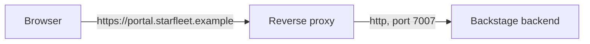

# Base URLs, Listen, CORS And The Reverse Proxy

A Backstage installation has to answer three separate questions about addresses. Where does the user type the portal address? Where does the browser send API requests? On which port does the backend process wait for connections? The configuration has a separate key for each question. When one key holds the wrong answer, the portal either does not load, loads but shows errors, or works in development and fails in production. This part explains the keys, how they relate and how a reverse proxy changes the picture.

## The three questions and their keys

The key `app.baseUrl` holds the address of the frontend app, that is, the address a user types in the browser. The key `backend.baseUrl` holds the address at which the backend can be reached from the outside. The frontend app reads it to build API request URLs, and other services read it when they call the backend. The key `backend.listen` tells the backend process what to bind to inside the machine or pod.

A configuration for local development looks like this:

```yaml
app:
  baseUrl: http://localhost:3000
backend:
  baseUrl: http://localhost:7007
  listen:
    port: 7007
  cors:
    origin: http://localhost:3000
```

In development the frontend runs on port 3000 and the backend on port 7007, so the two have different origins. An **origin** is the combination of scheme, host and port. `http://localhost:3000` and `http://localhost:7007` are different origins, because the ports differ.

## Why CORS exists

A browser enforces the **same-origin policy**: a page loaded from one origin may not read responses from another origin, unless that other origin allows it. The way to allow it is **CORS** (cross-origin resource sharing). The backend answers with a header, `Access-Control-Allow-Origin`, that names the allowed origin. If the header is missing or names another origin, the browser blocks the frontend app from reading the response.

Backstage sets this header from `backend.cors.origin`. The value has to match the origin of the page exactly: same scheme, same host and same port. `http://localhost:3000` does not match `https://localhost:3000`, and it does not match `http://localhost:3000/` with some tools that compare strings.

CORS is a browser rule. A command line client such as `curl` ignores it. A request that works from a terminal and fails in the browser is a typical sign of a CORS problem. CORS does not replace authentication, because it only controls which web pages may read responses.

## The reverse proxy

In production most teams put a **reverse proxy** in front of Backstage. A reverse proxy is a server that accepts requests from users, forwards them to another server and returns the response. Examples are an ingress controller, a load balancer or nginx. The proxy usually terminates TLS (Transport Layer Security), so users connect with HTTPS (HTTP over TLS) while the pod receives plain HTTP inside the cluster.

A common layout uses one public address for everything. The proxy sends requests under `/api` to the backend and all other requests to whatever serves the frontend bundle. The official Backstage image can serve the frontend from the backend process, so a single upstream on port 7007 is enough.



The diagram shows that the browser only knows the public address. The proxy holds the knowledge of the internal port.

With one public address, the values become simple. `app.baseUrl` and `backend.baseUrl` are both `https://portal.starfleet.example`, and `backend.cors.origin` is the same address, because page and API now share one origin. Requests from the page to the API are same-origin, so the browser does not run a CORS check at all, but the setting stays correct for tools and for an optional second frontend.

```yaml
app:
  baseUrl: https://portal.starfleet.example
backend:
  baseUrl: https://portal.starfleet.example
  listen:
    port: 7007
  cors:
    origin: https://portal.starfleet.example
```

## Listen versus base URL

The most common confusion is between `backend.listen` and `backend.baseUrl`. They describe two sides of the proxy. `backend.listen` describes the inside: the process binds to a port, and optionally a host. In a container the usual port is 7007, and the Kubernetes Service and the container port have to point at the same number. `backend.baseUrl` describes the outside: it is the address that appears in links and in API calls.

Changing `backend.listen.port` moves the process to a new port. Everything that connects to the pod, such as the Service, the health probes and the proxy, must then use the new port. Changing `backend.baseUrl` does not move anything. It only changes the address the backend and the frontend use to build URLs. If the proxy does not actually answer on that address, users get connection errors.

## Try it in the playground

The playground has a single Backstage pod behind a Service on port 7007. Print the current configuration:

<!-- astrona:playground:renew -->

```sh
kubectl -n backstage get configmap backstage-app-config -o jsonpath='{.data.app-config\.lab\.yaml}'
```

The command prints the file that the ConfigMap holds. Find `app.baseUrl`, `backend.baseUrl`, `backend.listen.port` and `backend.cors.origin`.

Save a changed copy of the three address values in a file named `app-config.lab.yaml` and put it back into the ConfigMap, or edit the ConfigMap directly:

```sh
kubectl -n backstage edit configmap backstage-app-config
```

Change `backend.cors.origin` to `https://portal.starfleet.example`. Saving the ConfigMap does not change the running process. Backstage reads its files at startup, so the new value has no effect until the pod restarts. Restart the Deployment and wait for it:

```sh
kubectl -n backstage rollout restart deployment/backstage
kubectl -n backstage rollout status deployment/backstage --timeout=300s
```

The `rollout restart` command creates a new pod from the same template, and the new process reads the changed file. The `rollout status` command returns when the new pod is ready.

## What a wrong value does

If `app.baseUrl` is wrong, links that Backstage builds, for example in sign-in redirects, point to an address that users cannot open. If `backend.baseUrl` is wrong, the frontend app sends API requests to an address that does not exist or that is not the backend. If `backend.cors.origin` is wrong, the browser blocks the response and the console shows a CORS error, while the backend log shows a normal request. If the listen port and the Service port differ, the pod runs but no request reaches it, and the readiness probe fails.

Notice that each wrong value fails in a different place and with a different symptom. The symptom tells you which key to check first.

This part separated the three address questions and showed how a reverse proxy lets all of them share one public address. The next question is how the backend plugins are reached once requests arrive, and how one plugin finds another.

## Common pitfalls

> [!WARNING]
> - **Changing the ConfigMap and expecting an immediate effect.** Backstage reads configuration at startup. Restart the pods after a change.
> - **Mixing up `listen` and `baseUrl`.** The first is the port of the process, the second is the public address.
> - **A CORS origin with the wrong scheme or port.** The value must equal the page origin exactly.
> - **Testing CORS with `curl`.** `curl` ignores CORS. Use the browser console.
> - **Changing the port in one place only.** The container port, the Service and the listen port must agree.
