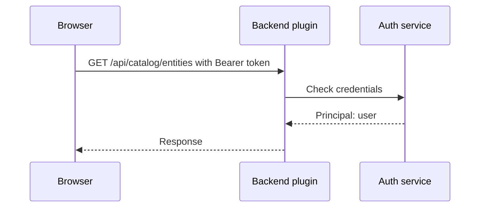

# Sign-In, Identity And Service Authentication

The backend serves catalog data, templates and documents, and some of it is private. Before the backend answers, it has to know who is asking. Two kinds of callers exist: people who sign in through the browser, and programs such as a CI (continuous integration) pipeline or another Backstage plugin. This part explains how each kind proves who it is, what a token is, and what the default auth policy does when a request carries no proof.

## Authentication and authorization

**Authentication** answers the question "who is this caller?". **Authorization** answers the question "what may this caller do?". The two steps happen in this order, and a failure in either one stops the request. This part covers authentication. The next topic covers authorization.

Backstage uses the word **credentials** for the proof a request carries. The backend turns credentials into a **principal**, which is the identity the rest of the request uses. A principal is a user, a service or, when no credentials exist, an anonymous caller.

## Sign-in for people

The frontend app shows a **sign-in page** before it shows any other page. The platform team configures one or more **auth providers**, for example GitHub, Google or an OIDC (OpenID Connect) identity provider. The user clicks a provider, the identity provider checks the person and sends the browser back to the backend of Backstage. The **auth backend plugin** receives the result and creates a Backstage identity.

The result is a **user token**. A user token is a JWT (JSON Web Token): a signed piece of text that states who the user is and which entities they belong to. The backend signs it with a key, so any plugin can verify that the token is real and has not been changed.

The frontend app holds the token and attaches it to every API call as an HTTP header: `Authorization: Bearer <token>`. In frontend code the `IdentityApi` gives access to the signed-in user, and the `fetchApi` adds the header automatically, which is why plugin code that uses `fetchApi` needs no extra work.

A development setup often uses the **guest provider**, which signs in without checking anyone. It is meant for development only. A production portal that leaves it on lets everyone in as a user.

## What the backend does with the token

When a request arrives at `/api/<pluginId>/...`, the backend plugin asks its **auth service** to read the credentials from the request. The auth service checks the signature and the expiry of the token. If the token is valid, the plugin gets a principal. If the header is missing or the token is not valid, the plugin gets no valid credentials.



The diagram shows that the plugin does not read the token itself. It delegates the check to the auth service, and the same check applies to every plugin.

## The default auth policy

Since the new backend system, the backend applies a **default auth policy**: every plugin route requires credentials. A request without valid credentials is rejected before the route handler runs. A plugin can opt out for specific routes, for example a health check, by adding an auth policy for that path with `addAuthPolicy`. The status code the backend returns for a rejected request is not documented as a fixed value, so tests should check that the request is not successful instead of expecting one number.

The policy can be switched off with the configuration key `backend.auth.dangerouslyDisableDefaultAuthPolicy: true`. The long name is a warning. With the key set, routes accept requests without credentials, and anyone who can reach the backend can read what the routes return. It exists for local development and not for a portal that holds real data.

## Service-to-service and external callers

Plugins that call each other cannot use a user token, because no user is present. The backend issues **service tokens** through the auth service, and the receiving plugin verifies them like any other token. This happens inside the backend and needs no configuration for the plugins of one deployment.

A caller outside Backstage, such as a CI pipeline, needs a way in too. The configuration key `backend.auth.externalAccess` lists such callers. A static entry looks like this:

```yaml
backend:
  auth:
    externalAccess:
      - type: static
        options:
          token: ${CI_TOKEN}
          subject: starfleet-ci
        accessRestrictions:
          - plugin: catalog
```

The `type: static` entry defines a fixed token for one caller. The `subject` names the caller in logs and in permission decisions. The `accessRestrictions` list limits the token to the plugin `catalog`, so the same token does not open the scaffolder. The value `${CI_TOKEN}` is a placeholder that Backstage replaces with the value of the environment variable `CI_TOKEN` when it starts. A second type, `jwks`, checks tokens that an identity provider signs, which avoids a shared fixed token.

## Try it in the playground

The playground configuration sets no authentication option, so the default auth policy is active. Request catalog data from inside the pod, without credentials:

<!-- astrona:playground:renew -->

```sh
kubectl -n backstage exec deploy/backstage -- node -e "fetch(http://localhost:7007/api/catalog/entities).then(r => console.log(r.status))"
```

The command prints the HTTP status of a request that carries no credentials. The status is not a documented constant, so note it from your own run, and check that it is not 200.

Now switch the policy off to see the difference. Open the ConfigMap with `kubectl -n backstage edit configmap backstage-app-config`, add `dangerouslyDisableDefaultAuthPolicy: true` under `backend.auth` (create the `auth` block if it is missing), and restart the Deployment:

```sh
kubectl -n backstage rollout restart deployment/backstage
kubectl -n backstage rollout status deployment/backstage --timeout=300s
```

Send the same request again. Without the policy, the route no longer asks for credentials, so the status changes. Remove the line again and restart, so the playground returns to its safe state.

## Choosing credentials for a caller

Match the caller to the credential. People use sign-in and a user token. Plugins inside the backend use service tokens that the backend issues. A pipeline in another system uses `externalAccess`, ideally with `jwks` or a token from a secret store. Give each external caller its own entry and its own restriction, so that you can remove one caller without touching the others, and so that logs show which caller did what.

This part showed how a request proves who sent it and what the backend does when no proof arrives. A known caller can still ask for things it should not receive. The next topic covers how the backend decides what each caller may do.

## Common pitfalls

> [!WARNING]
> - **Leaving `dangerouslyDisableDefaultAuthPolicy` set to `true` after a test.** Every route then answers requests without credentials.
> - **Using the guest provider in production.** It signs everyone in without a check.
> - **Writing the static token as a literal in the ConfigMap.** Use `${CI_TOKEN}` and deliver the value from a Secret.
> - **An `externalAccess` entry without `accessRestrictions`.** The token then works on every plugin.
> - **Expecting a fixed status code for rejected requests.** Test for "not successful" instead.
