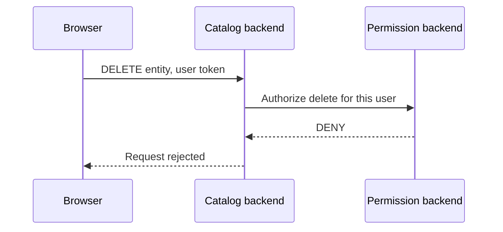

# Permission Decisions On The Server

Knowing who a caller is does not say what the caller may do. A signed-in developer may read every catalog entity but may not delete one. A CI caller may read the catalog but may not run templates. Backstage handles these questions with the permission framework. This part explains what the framework decides, which component makes the decision, why the decision has to happen on the server, and how to switch the framework on.

## What the permission framework is

The **permission framework** lets plugins ask a central question: "may this caller perform this action?". It has three parts. A **permission** is a named action, for example reading a catalog entity or creating a scaffolder task. A **policy** is code that the platform team writes or configures, and it answers the question for a caller and a permission. The **permission backend plugin**, with the plugin ID `permission`, receives the question from other plugins and runs the policy.

The framework is off by default. It is switched on with one setting:

```yaml
permission:
  enabled: true
```

With `enabled: false` or no value, plugins do not ask the question and behave as if every caller may do everything that authentication lets through.

## The three decisions

A policy returns one of three decisions for each request:

- **ALLOW**: the caller may do the action.
- **DENY**: the caller may not do the action.
- **CONDITIONAL**: the caller may do the action only for items that match a rule. The rule is a condition, for example "the entity is owned by a group of the caller".

The conditional decision exists because a list can contain many items. Instead of asking the policy once for every item, the plugin passes the condition to its own database query, and the query returns only the matching items. The catalog uses this for entity lists.

When no custom policy is installed, the framework uses a default policy that allows everything. Enabling the framework alone therefore does not restrict anyone. It prepares the path, and the policy provides the rules. The platform team writes a policy module for its own rules.

## Who enforces the decision

The plugin that owns the data enforces the decision. The catalog backend plugin asks the permission backend about each read, and it returns data only when the answer allows it. This enforcement point is a **plugin backend**, not the frontend app.



The diagram shows that the catalog backend asks and the permission backend answers. The permission backend does not delete anything and the catalog does not decide the rule, which keeps the policy in one place.

## Why the frontend cannot decide

The frontend app can ask the permission system too, usually to hide a button that the user may not use. This improves the interface, but it is not a security control. The code runs in the browser, and a user can change it, skip it or send the request by hand with another tool. A button that is hidden in the interface does not stop a direct request to the route.

The rule is therefore simple. Hiding is cosmetic and enforcing is the job of the backend. A plugin that only hides a button and does not check the permission on the server leaves the route open to everyone who is authenticated.

## Principals in permission decisions

A policy sees the principal that authentication produced. For a user, this includes the user entity reference and the groups the user belongs to, so a policy can write rules such as "owners of an entity may update it". For an external caller defined in `externalAccess`, the principal is a service with the `subject` name you set, for example `starfleet-ci`. A policy can treat that subject on its own.

This link between the two steps shows why authentication must come first. If the backend accepted anonymous calls, the policy would have no identity to reason about.

## Try it in the playground

Print the configuration and check whether the permission framework is enabled:

<!-- astrona:playground:renew -->

```sh
kubectl -n backstage get configmap backstage-app-config -o jsonpath='{.data.app-config\.lab\.yaml}'
```

Look for a `permission` block. If it is not there, the framework is off. Add `permission.enabled: true` with `kubectl -n backstage edit configmap backstage-app-config`, then restart the Deployment and wait for the new pod:

```sh
kubectl -n backstage rollout restart deployment/backstage
kubectl -n backstage rollout status deployment/backstage --timeout=300s
```

Read the backend log after the restart and look for lines about the permission plugin:

```sh
kubectl -n backstage logs deploy/backstage
```

The log lists the plugins that started. Whether a line for the permission plugin appears depends on the image and its logging level, so use the log as a hint and not as proof. The playground image uses its default policy, which is assumed to allow all requests, so enabling the framework does not change what a caller can read here.

## Failure cases

Three failures are common. The first is a framework that is enabled with the default policy, which gives a false sense of control: the setting shows `enabled: true` while every request is still allowed. The second is a plugin that does not call the framework, so its routes ignore the policy, because enforcement is the responsibility of each plugin. The third is a policy that denies by mistake and causes empty lists, which looks like missing data but is the result of a decision.

When a user reports missing data, check the status first. A 403 points at a deny decision. An empty list with a 200 status can point at a conditional decision that filtered everything out, or at real emptiness. The policy code and the principal of the caller explain which one it is.

This part showed that authorization is a decision made by a policy and enforced by the plugin that owns the data. One question remains: where do the credentials for outside systems live, so that the backend can act for users without exposing them.

## Common pitfalls

> [!WARNING]
> - **Treating `permission.enabled: true` as a restriction.** With the default policy every request is allowed. Write a policy for real rules.
> - **Hiding a button and calling it protection.** The route still answers a direct request.
> - **Assuming every plugin enforces permissions.** Each plugin decides which routes it checks.
> - **Reading an empty list as missing data.** A conditional decision can filter items out.
