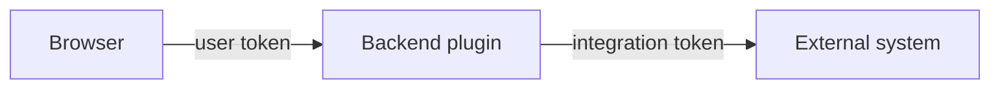

# Privileged Integrations And Credentials

A developer portal is useful because it connects to other systems: source control, CI, cloud accounts, Kubernetes clusters, ticket systems. Each connection needs a credential, such as a token or a key. These credentials are powerful, often more powerful than any single user. This part explains why they stay in the backend, how Backstage keeps them out of the browser, how to deliver them in Kubernetes, and what the user may see as a result.

## The trust boundary

A **trust boundary** is the line between code that you control and code that you do not control. The backend process runs on your servers, under your configuration. The browser runs on the computer of a user. Anything that reaches the browser can be read by that user, copied and sent to someone else.

A credential that the backend uses for an integration, for example a GitHub token that can read all repositories of the organization, must therefore never cross the boundary. The browser asks the backend for a result, and the backend uses the credential to call the other system. The user receives the data, and the credential stays on the server.



The diagram shows that the user token goes to the backend, and the integration token goes from the backend to the external system. The browser never sees the second one.

## Configuration visibility

Backstage reads one set of configuration files, and the browser needs a part of them. Each key has a **visibility**. The value `frontend` means the key is sent to the browser. The value `backend` is the default and keeps the key on the server. The value `secret` is a backend key that Backstage also redacts from logs and error output.

Plugins declare the visibility of their own keys in a configuration schema. A token key is declared as `secret`, so the value stays out of the frontend even when it sits in the same file as `app.baseUrl`. The practical rule for your own configuration is to check the schema of a plugin before putting a value in a key that you invented. Keys without a declared visibility default to `backend`.

## Keeping secrets out of the file

Configuration files live in a ConfigMap in this course, and a ConfigMap is not a place for secrets. Anyone who can read the ConfigMap can read the value, and it ends up in backups and in version control. Backstage supports substitution: a value written as `${CI_TOKEN}` is replaced with the value of the environment variable `CI_TOKEN` when the process starts.

In Kubernetes, a Secret holds the value, and the Deployment passes it to the container as an environment variable. The relevant part of the container spec looks like this:

```yaml
env:
  - name: CI_TOKEN
    valueFrom:
      secretKeyRef:
        name: portal-secrets
        key: CI_TOKEN
```

The `secretKeyRef` entry tells Kubernetes to read the key `CI_TOKEN` of the Secret `portal-secrets` when it creates the pod. The configuration file only contains the placeholder. A change of the Secret takes effect after a restart, because the environment of a running process does not change.

## The proxy and credentials

The proxy plugin shows the same pattern for ad hoc integrations. A route can add a header to the outgoing request, such as an `Authorization` header with a token. The token comes from `${...}` substitution, so it lives in the backend and the browser only calls `/api/proxy/<route>`. The `credentials` field of the route decides which callers may use the route. Because the route runs with the token of the platform, a route with `dangerously-allow-unauthenticated` gives every caller the same privileges as that token.

## Visibility of results

A privileged integration can return more than a user should see. If the backend uses an administrator token to list repositories, the response contains every repository, including private ones. The backend plugin must filter the result to what the caller may see, or enforce a permission decision before it returns data. The credential decides what the backend can read. The permission framework and the code of the plugin decide what the user receives.

This is why the three layers work together. Authentication tells the backend who asks. Authorization tells it what this caller may see. The server-side credential gives it the ability to fetch the data. Removing one layer makes the others unsafe.

## Try it in the playground

The playground has a Secret `portal-secrets` with the key `CI_TOKEN`. List the Secret keys without printing the value:

<!-- astrona:playground:renew -->

```sh
kubectl -n backstage get secret portal-secrets -o jsonpath='{.data}' | jq 'keys'
```

The command prints the key names only. Next check whether the Deployment reads the key into the container:

```sh
kubectl -n backstage get deployment backstage -o jsonpath='{.spec.template.spec.containers[0].env}'
```

If the output has no `CI_TOKEN` entry with a `secretKeyRef`, the placeholder in the configuration has nothing to read. Add the variable with `kubectl -n backstage edit deployment backstage`, and let Kubernetes roll out the new pod. Then read the configuration and make sure it holds `${CI_TOKEN}` and no literal token value:

```sh
kubectl -n backstage get configmap backstage-app-config -o jsonpath='{.data.app-config\.lab\.yaml}'
```

A literal value in this file is a finding. Replace it with the placeholder and restart.

## Rotation and exposure

A credential should change when someone who knew it leaves, or when it may have leaked. With a Secret and a placeholder, rotation takes three steps: change the value in the Secret, restart the pods, and revoke the old value at the other system. With a literal value in a ConfigMap, the old value also lives in every copy of the file, which makes revocation harder to prove.

Give each integration its own credential with the smallest rights it needs. Then a leak of one credential exposes one integration and not all.

This part showed why privileged credentials stay behind the backend, how visibility and substitution keep them out of the browser and the files, and why results still need filtering. You now have the complete path of a request: it arrives with credentials, passes a policy, and uses server-side credentials to reach the data.

## Common pitfalls

> [!WARNING]
> - **A literal token in the ConfigMap.** Use `${NAME}` and a Secret.
> - **Putting a token in a `frontend` key.** The browser receives every such key.
> - **Changing the Secret without a restart.** The process keeps the old environment variable.
> - **Using one powerful token for every integration.** A single leak then exposes everything.
> - **Returning raw integration results.** Filter by what the caller may see.
